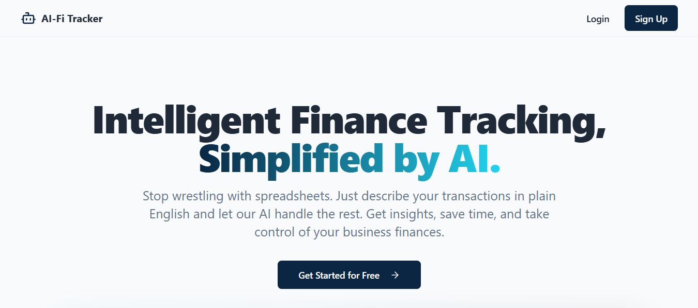

# AI Business Finance Tracker

A modern, AI-powered application designed to help you manage your business finances with ease. This application leverages AI for natural language transaction logging and financial insights, utilizing Supabase for robust backend services.



**[Live Demo](https://ai-fi.marcyovian.my.id) &middot; [Full Documentation](./docs/README.md)**

---

## ✨ Features

- **AI-Powered Assistant**:
  - Log transactions using natural language (e.g., "buy coffee for 50rb from cash").
  - Query your financial data with questions (e.g., "what were my total expenses last month?").
  - Get proactive budget warnings when logging expenses.
- **Interactive Dashboard**:
  - At-a-glance summary cards for income, expenses, and net profit.
  - Monthly income vs. expenses bar chart.
  - Expense breakdown by category with a pie chart.
  - AI-generated insights to highlight important trends.
- **Comprehensive Transaction Management**:
  - Full CRUD (Create, Read, Update, Delete) functionality for transactions.
  - Advanced filtering and sorting options.
  - Support for income, expense, and transfer types.
- **Monthly Budgeting**:
  - Set monthly budgets for different expense categories.
  - Track spending progress with visual indicators.
  - Real-time budget impact analysis when adding new transactions.
- **Settings & Configuration**:
  - Secure user authentication with Supabase Auth.
  - Manage income/expense categories, including nested sub-categories.
  - Manage fund sources (e.g., bank accounts, cash wallets).
  - Configure your preferred AI provider (OpenAI or Google Gemini).

## 🔧 Technologies Used

- **Frontend**: React, TypeScript, Vite
- **Styling**: Tailwind CSS, shadcn/ui
- **State Management**: TanStack Query (React Query)
- **Backend & Database**: Supabase (Auth, PostgreSQL, RPC Functions)
- **Charting**: Recharts
- **AI**: OpenAI API, Google Gemini API

## 📚 Documentation

For a complete overview of the project, including feature guides and technical references, please see the **[Full Documentation](./docs/README.md)**.

## 🚀 Getting Started

### Prerequisites

- Node.js (LTS)
- `npm` or `bun`
- A [Supabase](https://supabase.com/) project.

### Installation & Setup

1.  **Clone the repository:**

    ```bash
    git clone https://github.com/MarcYovian/ai-business-finance-tracker.git
    cd ai-business-finance-tracker
    ```

2.  **Install dependencies:**

    ```bash
    bun install
    ```

3.  **Configure environment variables:**
    Create a `.env` file from the `.env.example` and add your Supabase credentials:

    ```
    VITE_SUPABASE_URL="YOUR_SUPABASE_URL"
    VITE_SUPABASE_ANON_KEY="YOUR_SUPABASE_ANON_KEY"
    ```

4.  **Run the development server:**
    ```bash
    bun run dev
    ```

The application will be available at `http://localhost:5173`.

## 🤝 Contributing

Contributions are welcome! Please feel free to submit issues or pull requests.

## 📄 License

This project is licensed under the MIT License. See the `LICENSE` file for details.
