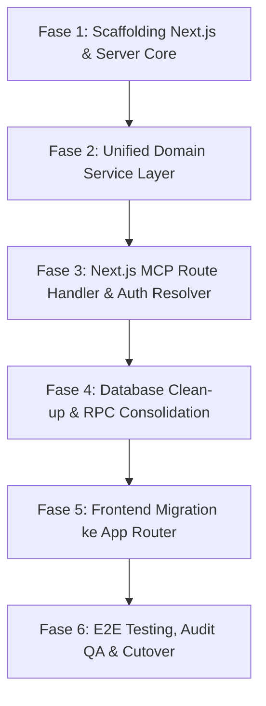

# Cetak Biru Arsitektur & Spesifikasi Migrasi: AI Business Finance Tracker
## Dari Vite + React SPA ke Next.js App Router, Unified Domain Service, dan Konsolidasi Supabase

- **Status Dokumen**: Approved Architecture Blueprint (RFC 2119 Compliant)
- **Versi**: 2.0.0
- **Tanggal**: 2026-10-31
- **Author**: Principal Technical Product Manager (`product-manager`)
- **Kolaborator**: `backend-engineer`, `database-engineer`, `frontend-engineer`
- **Repositori Target**: `/home/yann/apps/repos/ai-business-finance-tracker`

---

## 1. Latar Belakang & Akar Masalah (Current State & Root Cause)

Aplikasi **AI Business Finance Tracker** saat ini berjalan menggunakan stack Vite + React 18 SPA dengan backend Supabase (PostgreSQL 17). Hasil audit teknis menemukan sejumlah keterbatasan arsitektural dan technical debt yang mendesak untuk diperbaiki:

### A. Akar Masalah Duplikasi RPC Supabase (`mcp_*`)
- Pada implementasi awal, MCP server dijalankan secara terpisah menggunakan serverless function Vercel (`api/mcp.ts` dan `src/server/mcp/`).
- Klien MCP beroperasi menggunakan anon Supabase client tanpa sesi JWT Supabase (`auth.uid() = NULL`).
- Karena seluruh tabel dilindungi Row-Level Security (RLS) berbasis `auth.uid() = user_id`, kueri langsung dari klien MCP diblokir oleh PostgreSQL.
- Sebagai jalan pintas (*workaround*), dibuatlah 6 fungsi RPC PostgreSQL `SECURITY DEFINER` di `docs/migrations/2026-10-25_mcp_read_rpc.sql`:
  - `mcp_verify_auth`
  - `mcp_list_fund_sources`
  - `mcp_get_fund_source`
  - `mcp_list_categories`
  - `mcp_list_transactions`
  - `mcp_get_transaction`
- **Dampak Negatif**:
  1. Terjadi duplikasi kode dan query logic antara frontend (`src/lib/storage.ts`) dan database RPC (`mcp_*`).
  2. PostgreSQL terbebani menjadi API gateway yang mem-parse parameter filter (`p_start_date`, `p_end_date`, `p_limit`) di dalam PL/pgSQL.
  3. Linter keamanan Supabase mendeteksi fungsi-fungsi ini berstatus `SECURITY DEFINER` dan terbuka untuk dieksekusi oleh publik (`anon`).

### B. Fragmentasi Logika Bisnis & Celah Integritas Data
- **Inkonsistensi Mutasi Transfer**: Fungsi `createTransfer` pada `src/lib/storage.ts` melakukan insert mutasi transfer dan update saldo dompet secara terpisah dari browser (`Promise.all` + `fundSourceStorage.update`). Jika terjadi kegagalan koneksi di tengah proses, saldo akun menjadi desinkron. Sementara itu, MCP server menggunakan RPC atomik `create_transaction_and_update_balance`.
- **Eksekusi AI di Sisi Klien**: Kunci API OpenAI dan Google Gemini disimpan di browser `localStorage` (`src/lib/storage.ts`), dan pemanggilan model LLM dilakukan langsung dari browser (`src/services/aiService.ts`). Hal ini melanggar prinsip keamanan dasar (kunci API rentan terekspos) dan membebani bandwidth perangkat mobile pengguna.
- **Client-Side Auth Glitch**: `AuthContext` saat ini membaca auth token dari `localStorage`. Setiap kali membuka rute terproteksi, browser menampilkan loading spinner (`PageFallback`) sebelum mengecek token di client, memicu efek *redirect flash*.

---

## 2. Desain Arsitektur Target

Arsitektur target mengusung konsep **Unified Domain Service Pattern** di atas Next.js App Router. Seluruh consumer (UI Web, REST API, dan AI MCP Server) mengonsumsi logika bisnis yang SAMA dari Single Source of Truth (SSOT).

```
                                [ CONSUMER TIER ]
         ┌──────────────────────────────┼──────────────────────────────┐
         │                              │                              │
   [Next.js RSC &                [Next.js REST API             [Next.js MCP Endpoint
   Client Components]            Route Handlers]               /api/mcp (SSE / Stream)]
         │                              │                              │
         └──────────────────────────────┼──────────────────────────────┘
                                        ▼
                     ┌────────────────────────────────────┐
                     │     Unified Auth Guard Layer       │
                     │  - Web Session Cookie (@supabase)  │
                     │  - Bearer JWT (Mobile / External)  │
                     │  - Personal API Key (afi_live_...) │
                     └──────────────────┬─────────────────┘
                                        │
                                        ▼ Resolves AuthContext
                     ┌────────────────────────────────────┐
                     │   UNIFIED DOMAIN SERVICE LAYER     │
                     │  - TransactionDomainService        │
                     │  - FundSourceDomainService         │
                     │  - CategoryDomainService           │
                     │  - BudgetDomainService             │
                     │  - FinancialInsightDomainService   │
                     └──────────────────┬─────────────────┘
                                        │
                 ┌──────────────────────┴──────────────────────┐
                 │                                             │
                 ▼                                             ▼
     [Direct Query via Supabase SDK]             [PostgreSQL ACID RPCs]
     - Read data, list, filter, pagination       - create_transaction_and_update_balance
     - Single-row DML (Category, FundSource)     - update_transaction_and_update_balance
     - Terlindungi RLS & Scoped Client           - delete_transaction_and_revert_balance
                                                 - upsert_budget_with_items
```

### A. Prinsip Desain Unified Domain Service
1. **Zero Client Assumption**: Domain service tidak terikat pada HTTP request, cookies, atau browser. Service murni menerima parameter data dan objek `AuthContext`.
2. **Boundary Konversi Nilai Uang (Cents vs Rupiah)**:
   - Database PostgreSQL menyimpan seluruh nominal dalam satuan Cents (`bigint`) untuk mencegah galat pembulatan floating point IEEE 754.
   - Domain Service bertindak sebagai konverter: menerima input Rupiah (Number), mengubahnya menjadi Cents (`Math.round(amount * 100)`) untuk database, dan mengembalikan data dalam format Rupiah utuh ke consumer.
3. **Pemberian Wewenang Mutasi Finansial**:
   - Seluruh mutasi yang berdampak pada saldo akun wajib melalui fungsi PostgreSQL RPC ACID yang sudah teruji.
   - Dilarang keras melakukan update saldo manual dari sisi klien maupun dari Route Handler.

### B. Adaptasi MCP Server di Next.js App Router
- Endpoint MCP diimplementasikan pada Route Handler `src/app/api/mcp/route.ts` dengan runtime `nodejs` dan `force-dynamic`.
- Menggunakan transport stateless HTTP: `WebStandardStreamableHTTPServerTransport` dari `@modelcontextprotocol/sdk`.
- Tools MCP didesain tipis (*thin adapters*):
  - `list_transactions` -> memanggil `TransactionDomainService.list()`
  - `create_transaction` -> memanggil `TransactionDomainService.create()`
  - `update_transaction` -> memanggil `TransactionDomainService.update()`
  - `list_fund_sources` -> memanggil `FundSourceDomainService.list()`
  - `list_categories` -> memanggil `CategoryDomainService.list()`
  - `query_financial_insights` -> memanggil `FinancialInsightDomainService.getFinancialAnalysis()`

### C. Mekanisme Unifikasi Autentikasi (`AuthContext`)
Satu modul resolver `resolveAuthContext(req)` bertugas memvalidasi identitas dari 3 kanal:
1. **Web Session Cookie**: Menggunakan `@supabase/ssr` (`createServerClient`) dengan pembacaan cookie server.
2. **Personal API Key (MCP)**: Header `Authorization: Bearer afi_live_...` atau `x-api-key`. Kunci di-hash dengan SHA-256 dan diverifikasi via RPC `verify_api_key(p_key_hash)`.
3. **Bearer JWT Token**: Header `Authorization: Bearer <Supabase-JWT>` untuk integrasi pihak ketiga.

Struktur `AuthContext`:
```typescript
export interface AuthContext {
  userId: string;
  email?: string;
  authMethod: "session_cookie" | "api_key" | "jwt_bearer";
  keyHash?: string;
  scopes: string[];
  supabase: SupabaseClient;
}
```

---

## 3. Strategi Konsolidasi Supabase & Eliminasi Redundansi

### A. Eliminasi 100% Read RPC `mcp_*`
Dengan hadirnya Next.js server-side layer:
1. Seluruh otorisasi diselesaikan di server Next.js sebelum kueri dieksekusi.
2. Backend Next.js menggunakan Supabase client yang membawa konteks terautentikasi (atau scoped client dengan filter eksplisit `user_id = ctx.userId`).
3. Seluruh fungsi `mcp_*` read RPC di PostgreSQL (`mcp_list_transactions`, `mcp_list_fund_sources`, `mcp_list_categories`, `mcp_get_*`, `mcp_verify_auth`) **WAJIB DI-DROP**.
4. Dampak: Menghapus 160+ baris PL/pgSQL yang tidak perlu, menutup celah eksekusi publik anonim, dan menghilangkan kebutuhan update SQL setiap kali ada parameter filter baru.

### B. Matriks Keputusan: Kapan Direct SDK vs PostgreSQL RPC

| Operasi Data | Jalur Eksekusi | Alasan & Jaminan Integritas |
| :--- | :--- | :--- |
| **List & Detail Transaksi, Akun, Kategori, Notifikasi** | **Direct Supabase SDK** (`.from().select()`) | Kueri baca cepat, fleksibel untuk filter/pagination, optimal dengan cache Next.js. |
| **Create/Update/Delete Kategori & Dompet** | **Direct Supabase SDK** (`.insert()`, `.update()`, `.delete()`) | Mutasi single table yang tidak mempengaruhi saldo akun lain. RLS menjamin isolasi data user. |
| **Catat Transaksi (Income / Expense / Transfer)** | **PostgreSQL RPC** (`create_transaction_and_update_balance`) | **WAJIB RPC**: Mutasi jurnal transaksi dan pembaruan saldo akun sumber/tujuan wajib atomik (ACID). Pencatatan fee transfer anak juga otomatis terikat. |
| **Update Transaksi** | **PostgreSQL RPC** (`update_transaction_and_update_balance`) | **WAJIB RPC**: Membalikkan saldo transaksi lama, menghapus fee lama, memvalidasi kecukupan saldo baru, dan menerapkan saldo baru secara atomik. |
| **Hapus Transaksi** | **PostgreSQL RPC** (`delete_transaction_and_revert_balance`) | **WAJIB RPC**: Menghapus transaksi utama, menghapus fee terkait, dan mengembalikan saldo rekening ke kondisi awal. |
| **Simpan Anggaran (Budget + Items)** | **PostgreSQL RPC** (`upsert_budget_with_items`) | **WAJIB RPC**: Menyimpan header budget dan memperbarui alokasi kategori secara atomik (*clean replacement*). |
| **Reset Data Finansial Pengguna** | **PostgreSQL RPC** (`reset_user_financial_data`) | **WAJIB RPC**: Operasi pembersihan multi-tabel terisolasi per user. |
| **Agregasi Dashboard** | **PostgreSQL RPC** (`get_dashboard_summary`) | Mengurangi roundtrip jaringan dengan mengembalikan ringkasan saldo, income, expense dalam 1 request. |

### C. Pembersihan RPC Mutasi Lama (Legacy Duplicates)
Terdapat dua set fungsi RPC mutasi di database produksi:
- Set Aktif: `create_transaction_and_update_balance`, `update_transaction_and_update_balance`, `delete_transaction_and_revert_balance`.
- Set Usang (Legacy): `create_transaction_with_balance_update`, `update_transaction_with_balance_adjustment`, `delete_transaction_with_balance_adjustment`.
Set usang wajib di-drop untuk menghindari kebingungan dan kesalahan pemanggilan.

### D. Hardening Tabel `user_api_keys`
- Menambahkan kolom `scopes TEXT[] NOT NULL DEFAULT ARRAY['read', 'write']`.
- Menambahkan kolom `expires_at TIMESTAMPTZ` untuk masa berlaku kunci.
- Memperbaiki fungsi `verify_api_key`: menambahkan `SET search_path TO 'public'` guna mencegah serangan hijack search_path, dan mencabut izin eksekusi dari role `anon`.

---

## 4. Pemetaan Frontend: React SPA ke Next.js App Router

### A. Struktur Folder Target
```
src/
├── app/
│   ├── (marketing)/
│   │   ├── page.tsx                     # Landing Page (RSC)
│   │   ├── privacy-policy/page.tsx      # Privacy Policy (RSC)
│   │   └── terms-of-service/page.tsx    # Terms of Service (RSC)
│   ├── (auth)/
│   │   ├── layout.tsx                   # Auth layout shell
│   │   └── auth/page.tsx                # Login & Signup Form ('use client')
│   ├── (dashboard)/
│   │   ├── layout.tsx                   # Dashboard Layout (Sidebar + Header + Session Provider)
│   │   ├── dashboard/page.tsx           # Dashboard view (RSC + Client Widgets)
│   │   ├── accounts/page.tsx            # Accounts view
│   │   ├── transactions/page.tsx        # Transactions view
│   │   ├── budget/
│   │   │   ├── page.tsx                 # Monthly Budget view
│   │   │   └── history/page.tsx         # Budget History view
│   │   ├── categories/page.tsx          # Categories view
│   │   ├── ai-assistant/page.tsx        # AI Assistant chat view
│   │   └── settings/page.tsx            # Settings & API Keys view
│   ├── api/
│   │   ├── auth/callback/route.ts       # Supabase PKCE Code Exchange
│   │   ├── mcp/route.ts                 # Next.js MCP Server Route Handler
│   │   └── v1/...                       # REST Endpoints
│   ├── globals.css                      # Token warna, typography, layout
│   ├── layout.tsx                       # RootLayout (Fonts, ThemeProvider, QueryProvider)
│   ├── not-found.tsx                    # Error 404
│   └── error.tsx                        # Error Boundary
├── components/
│   ├── layout/                          # Sidebar, Header, MobileSheet
│   ├── ui/                              # shadcn/ui primitives
│   ├── providers/                       # TanStack Query & Theme Providers
│   └── [domain]/                        # Domain widgets (dashboard, transactions, budget)
├── hooks/                               # Custom React & TanStack Query hooks
├── lib/
│   ├── supabase/                        # @supabase/ssr (client.ts, server.ts, middleware.ts)
│   ├── currency.ts                      # Format mata uang IDR
│   └── utils.ts                         # Helper styling cn()
├── server/                              # Unified Server Core (SSOT)
│   ├── auth/                            # Unified Auth Resolver
│   ├── domain/                          # Business Services (transactions, budgets, fund-sources, insights)
│   └── mcp/                             # McpServer instance & tools registry
└── middleware.ts                        # Edge Route Guard & Session Refresh
```

### B. Klasifikasi Komponen Server (RSC) vs Komponen Klien (`'use client'`)

1. **Server Components (RSC) - Default**:
   - `layout.tsx` (RootLayout): Konfigurasi font lokal/Google via `next/font/google` (`Plus_Jakarta_Sans` & `Inter`), metadata SEO.
   - `src/app/(dashboard)/layout.tsx`: Membaca sesi dari cookie secara instan di server.
   - Halaman Route `page.tsx`: Membaca data awal menggunakan TanStack Query prefetch di server (`queryClient.prefetchQuery`), membungkus output dengan `<HydrationBoundary state={dehydrate(queryClient)}>`.
   - Landing page & static legal pages: Dirender statis di server untuk performa tinggi dan skor Core Web Vitals maksimal.

2. **Client Components (`'use client'`) - Interaktif**:
   - **Komponen Recharts**: Seluruh widget grafik (`BudgetVsSpendingChartWidget`, `MonthlyBalanceTrendWidget`, dll.) wajib `'use client'` dan di-load secara dinamis dengan `dynamic(() => import(...), { ssr: false })` untuk menghindari hydration mismatch canvas/SVG.
   - **Modal Form Dialog**: `TransactionDialog`, `BudgetFormDialog`, `TransferDialog`, `DeleteConfirmationDialog` (menggunakan React Hook Form + Zod).
   - **Filter & Toolbar Interaktif**: Filter tanggal, dropdown kategori, pagination kontrol.
   - **AI Chat View**: `AIAssistant.tsx` (mengelola scroll window DOM dan state input teks).
   - **Global Command Palette**: `cmdk` di `Header.tsx`.

### C. TanStack Query Singleton & Server Hydration
- Membuat `src/components/providers/query-provider.tsx` menggunakan pola singleton: membuat instance baru di server per request, dan menggunakan instance tunggal di browser.
- Di server `page.tsx`, data diprefetch dan diserialisasi via `dehydrate(queryClient)` sehingga saat browser membuka halaman, data langsung tampil tanpa flash loading skeleton.

### D. Migrasi Autentikasi ke `@supabase/ssr`
- Menghapus ketergantungan `localStorage` pada auth client.
- Mengimplementasikan `src/middleware.ts` untuk memeriksa cookie otentikasi di edge runtime:
  - Akses tanpa sesi ke rute dashboard langsung di-redirect HTTP 307 ke `/auth`.
  - Akses dengan sesi aktif ke `/auth` langsung di-redirect ke `/dashboard`.
- Mengeliminasi sepenuhnya glitch redirect flash di browser.

---

## 5. Keamanan & Sanitasi AI Service

1. **Pemindahan Kunci API AI ke Server**:
   - Seluruh pemanggilan OpenAI dan Google Gemini dipindahkan dari browser ke `src/server/domain/insights/ai-gateway.ts`.
   - Kunci API `OPENAI_API_KEY` dan `GEMINI_API_KEY` disimpan murni di Environment Variable server (Vercel / `.env.local`).
   - Browser pengguna hanya berinteraksi melalui Server Action atau Route Handler terproteksi, sehingga tidak ada risiko kebocoran kunci API.
2. **Sanitasi Error**:
   - REST API Route Handlers mengembalikan format standar RFC 7807 (`{ type, title, status, detail }`).
   - Endpoint MCP mengembalikan format standar JSON-RPC 2.0 (`{ jsonrpc: "2.0", error: { code, message } }`).
3. **Audit Log & Tracing**:
   - Header `X-Request-ID` disematkan pada setiap request yang masuk untuk memudahkan pelacakan insiden di server logs.

---

## 6. Skrip Migrasi Database & Rollback Plan

### A. Skrip Pembersihan & Konsolidasi: `docs/migrations/2026-11-01_consolidate_database_and_cleanup_mcp.sql`
```sql
BEGIN;

-- 1. Hardening verify_api_key (tutup celah search_path & cabut izin anon)
CREATE OR REPLACE FUNCTION public.verify_api_key(p_key_hash TEXT)
RETURNS UUID 
LANGUAGE plpgsql 
SECURITY DEFINER
SET search_path TO 'public'
AS $$
DECLARE
    v_user_id UUID;
    v_key_id UUID;
BEGIN
    SELECT id, user_id INTO v_key_id, v_user_id
    FROM public.user_api_keys
    WHERE key_hash = p_key_hash AND is_active = true
      AND (expires_at IS NULL OR expires_at > now())
    LIMIT 1;

    IF v_user_id IS NOT NULL THEN
        UPDATE public.user_api_keys
        SET last_used_at = now()
        WHERE id = v_key_id;
    END IF;

    RETURN v_user_id;
END;
$$;

REVOKE EXECUTE ON FUNCTION public.verify_api_key(TEXT) FROM PUBLIC;
REVOKE EXECUTE ON FUNCTION public.verify_api_key(TEXT) FROM anon;
GRANT EXECUTE ON FUNCTION public.verify_api_key(TEXT) TO authenticated, service_role;

-- 2. Peningkatan kolom tabel user_api_keys
ALTER TABLE public.user_api_keys 
  ADD COLUMN IF NOT EXISTS scopes TEXT[] NOT NULL DEFAULT ARRAY['read', 'write'],
  ADD COLUMN IF NOT EXISTS expires_at TIMESTAMPTZ;

-- 3. Indeks performa foreign key
CREATE INDEX IF NOT EXISTS idx_transactions_source_fund_id ON public.transactions (source_fund_id) WHERE source_fund_id IS NOT NULL;
CREATE INDEX IF NOT EXISTS idx_transactions_destination_fund_id ON public.transactions (destination_fund_id) WHERE destination_fund_id IS NOT NULL;
CREATE INDEX IF NOT EXISTS idx_categories_parent_id ON public.categories (parent_id) WHERE parent_id IS NOT NULL;
CREATE INDEX IF NOT EXISTS idx_recurring_patterns_category_id ON public.recurring_patterns (category_id) WHERE category_id IS NOT NULL;
CREATE INDEX IF NOT EXISTS idx_recurring_patterns_source_fund_id ON public.recurring_patterns (source_fund_id) WHERE source_fund_id IS NOT NULL;
CREATE INDEX IF NOT EXISTS idx_recurring_patterns_destination_fund_id ON public.recurring_patterns (destination_fund_id) WHERE destination_fund_id IS NOT NULL;

-- 4. Eliminasi duplikasi RPC mutasi lama
DROP FUNCTION IF EXISTS public.create_transaction_with_balance_update(text, bigint, text, uuid, uuid, uuid, timestamp with time zone, text, uuid);
DROP FUNCTION IF EXISTS public.update_transaction_with_balance_adjustment(uuid, bigint, uuid, uuid, timestamp with time zone, text, uuid, text);
DROP FUNCTION IF EXISTS public.delete_transaction_with_balance_adjustment(uuid);

-- 5. Eliminasi fungsi read RPC mcp_*
DROP FUNCTION IF EXISTS public.mcp_get_fund_source(uuid, uuid, text);
DROP FUNCTION IF EXISTS public.mcp_get_transaction(uuid, uuid, text);
DROP FUNCTION IF EXISTS public.mcp_list_categories(uuid, text, text);
DROP FUNCTION IF EXISTS public.mcp_list_fund_sources(uuid, text);
DROP FUNCTION IF EXISTS public.mcp_list_transactions(uuid, text, text, timestamp with time zone, timestamp with time zone, uuid, integer);
DROP FUNCTION IF EXISTS public.mcp_verify_auth(uuid, text);

COMMIT;
```

### B. Skrip Rollback: `docs/migrations/2026-11-01_rollback_mcp_read_rpc.sql`
Skrip pemulihan darurat jika arsitektur lama perlu dipulihkan sewaktu-waktu:
```sql
BEGIN;

CREATE OR REPLACE FUNCTION public.mcp_verify_auth(p_user_id UUID, p_key_hash TEXT DEFAULT NULL)
RETURNS UUID LANGUAGE plpgsql SECURITY DEFINER SET search_path TO 'public' AS $$
DECLARE v_verified_user_id UUID;
BEGIN
    IF auth.uid() IS NOT NULL THEN
        IF auth.uid() != p_user_id THEN RAISE EXCEPTION 'Unauthorized: User ID mismatch'; END IF;
        RETURN auth.uid();
    ELSIF p_key_hash IS NOT NULL THEN
        SELECT user_id INTO v_verified_user_id FROM public.user_api_keys
        WHERE key_hash = p_key_hash AND is_active = true LIMIT 1;
        IF v_verified_user_id IS NULL OR v_verified_user_id != p_user_id THEN
            RAISE EXCEPTION 'Unauthorized: Invalid or inactive API key';
        END IF;
        UPDATE public.user_api_keys SET last_used_at = now() WHERE key_hash = p_key_hash;
        RETURN v_verified_user_id;
    ELSE
        RAISE EXCEPTION 'Unauthorized: Missing authentication context';
    END IF;
END;
$$;

CREATE OR REPLACE FUNCTION public.mcp_list_fund_sources(p_user_id UUID, p_key_hash TEXT DEFAULT NULL)
RETURNS SETOF public.fund_sources LANGUAGE plpgsql SECURITY DEFINER SET search_path TO 'public' AS $$
DECLARE v_uid UUID;
BEGIN
    v_uid := public.mcp_verify_auth(p_user_id, p_key_hash);
    RETURN QUERY SELECT * FROM public.fund_sources WHERE user_id = v_uid ORDER BY created_at ASC;
END;
$$;

CREATE OR REPLACE FUNCTION public.mcp_list_categories(p_user_id UUID, p_key_hash TEXT DEFAULT NULL, p_type TEXT DEFAULT NULL)
RETURNS SETOF public.categories LANGUAGE plpgsql SECURITY DEFINER SET search_path TO 'public' AS $$
DECLARE v_uid UUID;
BEGIN
    v_uid := public.mcp_verify_auth(p_user_id, p_key_hash);
    RETURN QUERY SELECT * FROM public.categories WHERE user_id = v_uid AND (p_type IS NULL OR type = p_type) ORDER BY name ASC;
END;
$$;

CREATE OR REPLACE FUNCTION public.mcp_list_transactions(p_user_id UUID, p_key_hash TEXT DEFAULT NULL, p_type TEXT DEFAULT NULL, p_start_date TIMESTAMPTZ DEFAULT NULL, p_end_date TIMESTAMPTZ DEFAULT NULL, p_category_id UUID DEFAULT NULL, p_limit INT DEFAULT 50)
RETURNS SETOF public.transactions LANGUAGE plpgsql SECURITY DEFINER SET search_path TO 'public' AS $$
DECLARE v_uid UUID;
BEGIN
    v_uid := public.mcp_verify_auth(p_user_id, p_key_hash);
    RETURN QUERY SELECT * FROM public.transactions WHERE user_id = v_uid AND (p_type IS NULL OR type = p_type) AND (p_start_date IS NULL OR transaction_date >= p_start_date) AND (p_end_date IS NULL OR transaction_date <= p_end_date) AND (p_category_id IS NULL OR category_id = p_category_id) ORDER BY transaction_date DESC LIMIT LEAST(GREATEST(p_limit, 1), 100);
END;
$$;

COMMIT;
```

---

## 7. Roadmap Tahapan Eksekusi Migrasi (6 Fase)



### Fase 1: Scaffolding Next.js & Server Core
- Tambahkan dependencies: `next@latest`, `@supabase/ssr`, update `@types/node`.
- Konfigurasi `next.config.mjs`, `next/font/google` (`Plus_Jakarta_Sans` & `Inter`).
- Perbarui `components.json` (`rsc: true`) dan `tailwind.config.ts`.
- Siapkan struktur folder server: `src/server/auth/`, `src/server/domain/`, `src/server/mcp/`.

### Fase 2: Implementasi Unified Domain Service Layer
- Bangun `TransactionDomainService`: list, getById, create, update, delete (dengan integrasi RPC atomik).
- Bangun `FundSourceDomainService` & `CategoryDomainService`.
- Bangun `BudgetDomainService`: integrasi `upsert_budget_with_items` dan `get_or_create_budget_for_month`.
- Bangun `FinancialInsightDomainService`: migrasi `QueryEngine` in-memory ke server layer.
- Unit testing domain services: jamin 100% lulus.

### Fase 3: Adaptasi MCP Route Handler & Auth Resolver
- Buat `src/server/auth/resolver.ts` yang menangani Session Cookie, Bearer JWT, dan `afi_` API Key.
- Buat Route Handler `src/app/api/mcp/route.ts` dengan Streamable HTTP Transport.
- Porting MCP tools agar memanggil Unified Domain Service.
- Hapus duplikasi folder lama `api/_lib/` dan `src/server/mcp/` lama.

### Fase 4: Eksekusi Migrasi Database & Konsolidasi RPC
- Eksekusi migrasi hardening pada database Supabase menggunakan `docs/migrations/2026-11-01_consolidate_database_and_cleanup_mcp.sql`.
- Drop seluruh fungsi `mcp_*` read RPC dan drop legacy duplicate mutation RPCs.
- Verifikasi bahwa MCP Route Handler baru tetap berfungsi normal via direct query berfilter `user_id`.

### Fase 5: Migrasi Frontend ke App Router
- Siapkan `src/lib/supabase/{client.ts, server.ts, middleware.ts}` dan `src/middleware.ts` untuk route guard.
- Siapkan `src/components/providers/query-provider.tsx` (singleton QueryClient).
- Porting layout: `src/app/layout.tsx` dan `src/app/(dashboard)/layout.tsx`.
- Porting halaman per modul:
  1. Marketing & Legal pages (`(marketing)/page.tsx`, `privacy-policy/page.tsx`).
  2. Auth page (`(auth)/auth/page.tsx`).
  3. Dashboard (`dashboard/page.tsx`) dengan prefetching RSC.
  4. Transaksi (`transactions/page.tsx`).
  5. Budget & History (`budget/page.tsx`).
  6. Accounts & Categories (`accounts/page.tsx`, `categories/page.tsx`).
  7. AI Assistant (`ai-assistant/page.tsx`) & Settings (`settings/page.tsx`).
- Konversi Recharts widgets ke dynamic client imports (`ssr: false`).
- Pindahkan penyimpanan API key AI dari `localStorage` ke server env.

### Fase 6: Pengujian E2E, Quality Gate, dan Cutover
- Hapus build tools lama: `vite`, `@vitejs/plugin-react-swc`, `react-router-dom`.
- Verifikasi build produksi: `npm run build` tanpa error hydration mismatch atau typescript error.
- Delegasikan ke `qa-engineer` untuk pengujian regresi Playwright E2E dan pengujian automated endpoint MCP.
- Delegasikan ke `qa-specialist` untuk audit kepatuhan kriteria akseptasi, zero-data-loss verification, dan verifikasi WCAG 2.2.
- Deployment final ke Vercel dan rilis produksi.

---

## 8. Matriks Risiko & Rencana Mitigasi

| Risiko Potensial | Tingkat Risiko | Dampak | Strategi Mitigasi Terencana |
| :--- | :---: | :--- | :--- |
| **Hydration Mismatch pada Recharts** | Sedang | UI crash / warning di konsol browser | Seluruh grafik Recharts di-render menggunakan `dynamic(..., { ssr: false })` dengan fallback `<Skeleton />`. |
| **Koneksi MCP Terputus (Timeout)** | Sedang | AI Assistant eksternal gagal merespons | Menggunakan `export const maxDuration = 60` dan streaming response chunked pada Next.js Route Handler. |
| **Desinkronisasi Sesi Auth di SSR** | Rendah | User terlempar ke halaman `/auth` | Menggunakan `@supabase/ssr` resmi dengan sinkronisasi cookie melalui `middleware.ts`. |
| **Kegagalan Query Setelah Drop `mcp_*`** | Rendah | Endpoint MCP read error | Direct query menggunakan Supabase SDK teruji pada Domain Service sebelum skrip drop dieksekusi; skrip rollback SQL disiapkan instan. |
| **Pembulatan Mata Uang Pecahan** | Kritis | Selisih kas pembukuan | Integritas Cents (`bigint`) dijaga ketat di database; konversi Rupiah hanya dilakukan di batas Domain Service via `Math.round(amount * 100)`. |
