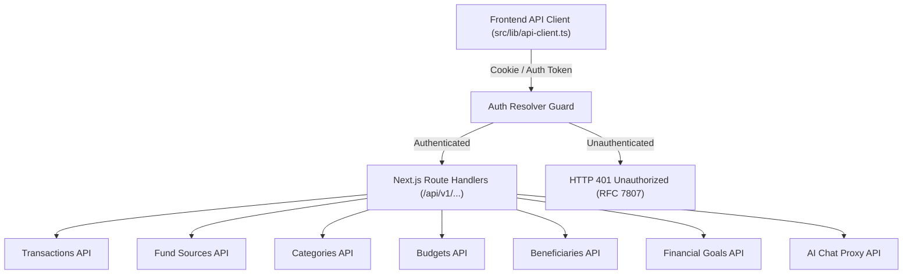
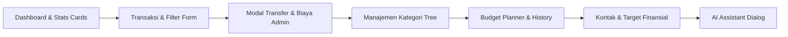
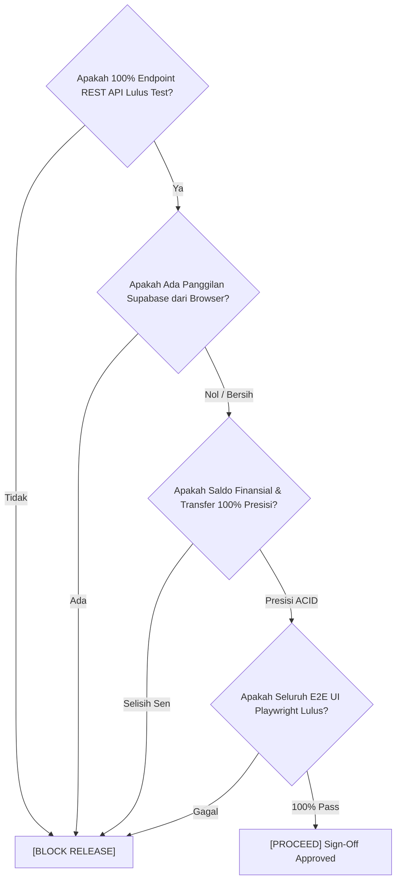

# Quality Assurance Test Strategy & Quality Gate Specification
## Migrasi 100% Frontend ke Next.js REST API (/api/v1/...)
### Proyek: AI Business Finance Tracker

- **Dokumen**: `QA_API_MIGRATION_STRATEGY.md`
- **Versi**: 1.0.0
- **Tanggal**: 31 Oktober 2026
- **Lead Evaluator**: Principal Quality Assurance Specialist (`qa-specialist`)
- **Target Repositori**: `/home/yann/apps/repos/ai-business-finance-tracker`
- **Execution Workspace**: `/home/yann/playwright-tools`
- **Status Dokumen**: APPROVED FOR QA AUTOMATION HANDOFF

---

## 1. Latar Belakang & Sasaran Kualitas Migrasi

Migrasi ini mengalihkan seluruh komunikasi data dari browser ke server secara penuh:
1. **Eliminasi 100% Supabase Client di Browser**:
   Browser dilarang keras menginisialisasi atau memanggil `@supabase/supabase-js` secara langsung. Seluruh query tabel (`supabase.from(...)`) dan RPC (`supabase.rpc(...)`) di sisi browser harus ditiadakan.
2. **Unified REST API Gateway (/api/v1/...)**:
   Semua operasi CRUD dan mutasi finansial wajib melalui Next.js REST API Route Handlers di bawah prefix `/api/v1/`.
3. **Type-Safe API Client (`src/lib/api-client.ts`)**:
   Frontend mengonsumsi data secara konsisten melalui client layer yang menangani serialisasi, deserialisasi, cookie session propagation, dan standardisasi error RFC 7807.
4. **Mandat Pengujian Menyeluruh**:
   Pengujian wajib mencakup 100% fitur sistem tanpa kompromi, mulai dari endpoint API kontrak backend hingga alur interaksi pengguna di UI E2E Playwright.

---

## 2. Risk Assessment Matrix (Matriks Penilaian Risiko)

| ID Risiko | Area & Deskripsi Risiko | Probabilitas | Dampak | Tingkat Risiko | Rencana Mitigasi QA | Metode Verifikasi Otomatis |
| :--- | :--- | :---: | :---: | :---: | :--- | :--- |
| **RSK-01** | **Kebocoran Panggilan Supabase di Browser**: Sisa kode lama di komponen atau hooks masih memanggil `supabase.from()` langsung ke domain Supabase. | Tinggi | Kritis | **Sangat Tinggi** | Pasang network traffic interceptor pada Playwright yang memblokir dan mendeteksi request ke `*.supabase.co`. | Playwright `page.on('request')` memantau URL; fail tes seketika jika ada traffic ke Supabase dari browser. |
| **RSK-02** | **Desinkronisasi Tipe Data (Cents vs Rupiah & camelCase vs snake_case)**: Payload DTO dari REST API tidak sinkron dengan tipe frontend (misal `amount` sen vs rupiah atau `transaction_date` vs `transactionDate`). | Tinggi | Kritis | **Sangat Tinggi** | Verifikasi kontrak skema Zod pada API Client dan validasi DTO serialisasi di kedua sisi (BE dan FE). | Automated REST API schema test dan snapshot assertion untuk setiap respons endpoint. |
| **RSK-03** | **Kegagalan Atomik Transfer Antar-Akun**: Transfer saldo dan pemotongan biaya admin tidak selesai dalam 1 transaksi ACID, menyebabkan saldo gantung. | Rendah | Kritis | **Tinggi** | Mandatkan pemanggilan endpoint `/api/v1/transactions/transfer` yang memicu RPC database tunggal. | API test transfer dengan simulasi saldo pas-pasan, fee positif, dan verifikasi saldo akhir kedua rekening. |
| **RSK-04** | **Bypass Validasi Saldo Tidak Cukup (Insufficient Funds)**: Pengeluaran atau transfer melebihi saldo akun lolos ke database tanpa ditolak. | Sedang | Tinggi | **Tinggi** | Pastikan domain service dan route handler melempar `InsufficientFundsError` berstatus 400/422. | Negative test API: kirim request transaksi dengan amount > balance, verifikasi HTTP 400 dan error RFC 7807. |
| **RSK-05** | **Regresi Perhitungan Budget & Riwayat Alokasi**: Penggantian alokasi budget (`upsert`) gagal merapikan item lama atau riwayat bulan sebelumnya tidak terambil. | Sedang | Tinggi | **Tinggi** | Validasi endpoint `/api/v1/budgets`, `/api/v1/budgets/details`, dan `/api/v1/budgets/previous` dengan data relasional lengkap. | API suite budget: buat budget baru, tambah item, bandingkan dengan realisasi transaksi, verifikasi riwayat. |
| **RSK-06** | **Kegagalan Propagasi Sesi Autentikasi**: Cookie sesi Supabase tidak terbawa pada panggilan fetch `api-client.ts` di browser atau SSR RSC. | Sedang | Kritis | **Tinggi** | Konfigurasi `credentials: 'same-origin'` pada API client dan verifikasi header `Cookie` di resolver auth backend. | E2E Playwright test sesi login, mutasi data, reload halaman, dan verifikasi state tetap persisten. |
| **RSK-07** | **Inkonsistensi Format Error RFC 7807**: Route handler mengembalikan format error acak (plain text, HTML 500, atau objek non-standar) sehingga UI toast rusak. | Sedang | Sedang | **Sedang** | Standarisasi seluruh catch block route handler untuk mengembalikan `DomainError.toRFC7807()`. | API negative test suite: verifikasi setiap respon error 4xx/5xx memiliki field `type`, `title`, `status`, dan `detail`. |
| **RSK-08** | **Timeout & Error Handling Proxy AI Chat**: Endpoint `/api/v1/ai/chat` hang atau gagal menangani stream respons saat rate limit provider AI tercapai. | Sedang | Sedang | **Sedang** | Bungkus handler AI dengan timeout guard 30s dan fallback pesan error yang ramah pengguna. | API integration test `/api/v1/ai/chat` dengan payload prompt valid dan mock error provider. |

---

## 3. Cakupan Pengujian 100% REST API (Contract & Integration)

Seluruh route handler wajib diuji dengan kriteria response status, headers, dan struktur payload data berikut:



### A. Modul Transaksi & Transfer
1. **`GET /api/v1/transactions`**:
   - Query params: `type`, `categoryId`, `startDate`, `endDate`, `limit`, `offset`.
   - Expected: HTTP 200 `{ data: TransactionDTO[] }`. Nominal amount dalam format Rupiah asli.
2. **`POST /api/v1/transactions`**:
   - Payload: `{ description, amount, type, transactionDate, categoryId?, sourceFundId?, destinationFundId?, fee?, notes? }`.
   - Expected: HTTP 201 `{ data: TransactionDTO }`. Saldo dompet terpotong/bertambah secara atomik.
   - Negative test: Pengeluaran melebihi saldo akun -> HTTP 400 Insufficient Funds RFC 7807.
3. **`GET /api/v1/transactions/[id]`**:
   - Expected: HTTP 200 `{ data: TransactionDTO }` jika id valid milik pengguna.
   - Negative test: ID acak -> HTTP 404 Not Found RFC 7807.
4. **`PATCH /api/v1/transactions/[id]`**:
   - Payload: Perubahan nominal atau deskripsi transaksi.
   - Expected: HTTP 200 `{ data: TransactionDTO }`. Saldo rekening ter-update sesuai selisih nominal baru vs lama.
5. **`DELETE /api/v1/transactions/[id]`**:
   - Expected: HTTP 200 `{ success: true }`. Saldo rekening dikembalikan (revert) secara presisi.
6. **`POST /api/v1/transactions/transfer`**:
   - Payload: `{ sourceFundId, destinationFundId, amount, fee?, notes? }`.
   - Expected: HTTP 201 `{ data: { transferTransaction, feeTransaction?, sourceBalance, destinationBalance } }`.
   - Negative test: `sourceFundId == destinationFundId` -> HTTP 422 Validation Error.
   - Negative test: Saldo sumber < amount + fee -> HTTP 400 Insufficient Funds.

### B. Modul Sumber Dana (Fund Sources / Rekening)
1. **`GET /api/v1/fund-sources`**:
   - Query params: `activeOnly=true|false`, `summary=true|false`.
   - Expected: HTTP 200 `{ data: FundSourceDTO[] }` atau `{ data: BalanceSummaryDTO }`.
2. **`POST /api/v1/fund-sources`**:
   - Payload: `{ name, balance, type, accountNumber?, accountHolderName?, colorTheme?, isActive? }`.
   - Expected: HTTP 201 `{ data: FundSourceDTO }`.
3. **`GET /api/v1/fund-sources/[id]`**:
   - Expected: HTTP 200 `{ data: FundSourceDTO }`.
4. **`PATCH /api/v1/fund-sources/[id]`**:
   - Payload: `{ name?, balance?, colorTheme?, isActive? }`.
   - Expected: HTTP 200 `{ data: FundSourceDTO }`.
5. **`DELETE /api/v1/fund-sources/[id]`**:
   - Expected: HTTP 200 `{ success: true }`. Validasi jika masih ada transaksi terkait.

### C. Modul Kategori Transaksi
1. **`GET /api/v1/categories`**:
   - Query params: `type=income|expense`.
   - Expected: HTTP 200 `{ data: CategoryDTO[] }` dengan hierarki parent/child terpetakan rapi.
2. **`POST /api/v1/categories`**:
   - Payload: `{ name, type, parentId?, color?, icon?, description?, sortOrder? }`.
   - Expected: HTTP 201 `{ data: CategoryDTO }`.
3. **`PATCH /api/v1/categories/[id]`**:
   - Expected: HTTP 200 `{ data: CategoryDTO }`.
4. **`DELETE /api/v1/categories/[id]`**:
   - Expected: HTTP 200 `{ success: true }`.

### D. Modul Anggaran (Budgets & History)
1. **`GET /api/v1/budgets`**:
   - Query params: `month=YYYY-MM-DD`, `history=true|false`.
   - Expected: HTTP 200 `{ data: BudgetDTO }` atau `{ data: BudgetHistoryDTO[] }`.
2. **`POST /api/v1/budgets`**:
   - Payload: `{ name, startDate, endDate, items: [{ categoryId, amount }] }`.
   - Expected: HTTP 200 `{ data: BudgetDTO }`.
3. **`GET /api/v1/budgets/details`**:
   - Query param: `budgetId=uuid`.
   - Expected: HTTP 200 `{ data: BudgetDetailDTO[] }` (alokasi rencana vs realisasi pengeluaran aktual per kategori).
4. **`GET /api/v1/budgets/previous`**:
   - Query param: `currentMonth=YYYY-MM-DD`.
   - Expected: HTTP 200 `{ data: PreviousBudgetDTO | null }` untuk fitur salin anggaran bulan lalu.

### E. Modul Kontak Penerima (Beneficiaries)
1. **`GET /api/v1/beneficiaries`**:
   - Expected: HTTP 200 `{ data: BeneficiaryDTO[] }`.
2. **`POST /api/v1/beneficiaries`**:
   - Payload: `{ name, account_number, bank_name, notes? }`.
   - Expected: HTTP 201 `{ data: BeneficiaryDTO }`.
3. **`DELETE /api/v1/beneficiaries/[id]`**:
   - Expected: HTTP 200 `{ success: true }`.

### F. Modul Target Finansial (Financial Goals)
1. **`GET /api/v1/financial-goals`**:
   - Expected: HTTP 200 `{ data: FinancialGoalDTO[] }` terurut berdasarkan prioritas dan target tanggal.
2. **`POST /api/v1/financial-goals`**:
   - Payload: `{ name, target_amount, current_amount?, category, target_date, priority? }`.
   - Expected: HTTP 201 `{ data: FinancialGoalDTO }`.
3. **`PATCH /api/v1/financial-goals/[id]`**:
   - Payload: Update progres tabungan atau tanggal target.
   - Expected: HTTP 200 `{ data: FinancialGoalDTO }`.
4. **`DELETE /api/v1/financial-goals/[id]`**:
   - Expected: HTTP 200 `{ success: true }`.

### G. Modul Asisten AI (Chat Proxy)
1. **`POST /api/v1/ai/chat`**:
   - Headers: Cookie auth aktif atau API key.
   - Payload: `{ message: string, history?: ChatMessage[], context?: { currentMonth?: string } }`.
   - Expected: HTTP 200 `{ reply: string, actions?: AIActionSuggestion[] }`.
   - Negative test: Unauthenticated request -> HTTP 401.

---

## 4. Cakupan Pengujian UI E2E Playwright (User Journeys)

Test suite Playwright di `/home/yann/playwright-tools/tests/` mencakup seluruh alur layar:



### 1. Dashboard Overview & Financial Summary (`e2e-api-dashboard.spec.js`)
- Verifikasi kartu Total Saldo, Pemasukan Bulan Ini, Pengeluaran Bulan Ini terisi data via REST API.
- Verifikasi widget grafik tren dan grafik alokasi budget ter-render tanpa hydration error.
- **Pemeriksaan Wajib**: Pasang listener request browser, pastikan 0 call ke domain Supabase (`nfvjwkimzlqszwpydees.supabase.co`). Seluruh network traffic data mengarah ke `/api/v1/...`.

### 2. Siklus Lengkap Transaksi (`e2e-api-transactions.spec.js`)
- Buka modal Tambah Transaksi, pilih jenis Pengeluaran, isi form, dan simpan.
- Verifikasi baris transaksi baru langsung muncul di tabel tanpa reload halaman.
- Verifikasi saldo dompet yang bersangkutan langsung berkurang sesuai nominal.
- Uji validasi batas saldo: Input nominal pengeluaran melebihi saldo akun, verifikasi toast error RFC 7807 muncul dan form tetap terbuka.
- Edit transaksi: Ubah nominal transaksi lama, verifikasi saldo dompet menyesuaikan secara akurat.
- Hapus transaksi: Klik tombol hapus, verifikasi dialog konfirmasi, dan saldo dompet kembali ke posisi semula.

### 3. Transfer Saldo Antar-Akun & Biaya Admin (`e2e-api-transfers.spec.js`)
- Buka modal Transfer Dana, pilih rekening asal (misal: Bank Mandiri) dan rekening tujuan (misal: Kas Dompet).
- Masukkan nominal transfer Rp 250.000 dengan biaya admin Rp 2.500.
- Submit transfer, verifikasi respon sukses.
- Periksa saldo kedua akun: Saldo Bank Mandiri berkurang Rp 252.500, saldo Kas Dompet bertambah Rp 250.000.
- Verifikasi pada riwayat transaksi muncul pencatatan mutasi transfer yang valid.

### 4. Manajemen Kategori & Sub-Kategori (`e2e-api-categories.spec.js`)
- Buka halaman Kategori, navigasikan tab Pemasukan dan Pengeluaran.
- Tambah kategori baru dengan warna dan ikon kustom.
- Tambah sub-kategori yang menginduk ke kategori utama.
- Edit nama kategori dan verifikasi pembaruan seketika di UI list.
- Hapus kategori uji dan pastikan terhapus bersih dari state UI.

### 5. Perencanaan Anggaran & Salin Bulan Lalu (`e2e-api-budgets.spec.js`)
- Akses halaman Budget Planner.
- Pilih bulan berjalan, set alokasi anggaran pada 3 kategori pengeluaran.
- Verifikasi progress bar pemakaian anggaran mencerminkan pengeluaran riil bulan berjalan.
- Uji tombol "Salin dari Bulan Sebelumnya": Verifikasi alokasi otomatis terisi sesuai data budget riwayat dari endpoint `/api/v1/budgets/previous`.

### 6. Kontak Penerima & Target Finansial (`e2e-api-beneficiaries-goals.spec.js`)
- Tambah kontak penerima transfer baru (nama, bank, nomor rekening).
- Buka modal transfer, pastikan kontak penerima dapat dipilih secara instan.
- Buka halaman Target Finansial (Financial Goals).
- Buat target tabungan baru dengan target nominal Rp 10.000.000 dan tenggat waktu tertentu.
- Update setoran berkala, verifikasi persentase pencapaian target bertambah.

### 7. Asisten Keuangan AI (`e2e-api-ai-chat.spec.js`)
- Buka panel obrolan AI Assistant di sidebar atau floating action.
- Kirim pesan: "Berapa sisa budget pengeluaran saya bulan ini?".
- Verifikasi indikator loading/typing aktif, lalu AI menjawab dengan ringkasan akurat yang bersumber dari API proxy `/api/v1/ai/chat`.

### 8. Proteksi Sesi & Pengaturan Akun (`e2e-api-auth-guard.spec.js`)
- Buka browser incognito / tanpa cookie sesi, coba akses langsung `/transactions` atau `/budget`.
- Verifikasi Edge Middleware mengembalikan redirect HTTP 307 seketika ke `/auth` tanpa memunculkan flash DOM dashboard.
- Lakukan login dengan kredensial valid, verifikasi redirect kembali ke dashboard dengan state sesi terisi.

---

## 5. Skenario BDD Gherkin untuk Kasus Kritis

### Skenario 1: Transaksi Pengeluaran Berhasil Melalui REST API
```gherkin
Feature: Pencatatan Transaksi Pengeluaran via REST API
  As an authenticated user
  I want to record an expense transaction via the REST API
  So that my balance is deducted and the journal is updated accurately

  Scenario: Pencatatan pengeluaran dengan saldo mencukupi
    Given Pengguna terautentikasi memiliki rekening "Kas Operasional" dengan saldo Rp 1.000.000
    When Pengguna mengirim request "POST /api/v1/transactions" dengan payload:
      | description     | Biaya Listrik Kantor |
      | amount          | 350000               |
      | type            | expense              |
      | sourceFundId    | <kas-operasional-id> |
      | categoryId      | <utilitas-id>        |
    Then Sistem mengembalikan respon HTTP 201 Created
    And Payload respon berformat JSON dengan data transaksi baru
    And Saldo "Kas Operasional" pada "GET /api/v1/fund-sources" menjadi Rp 650.000
    And Tidak ada panggilan jaringan ke domain Supabase dari browser
```

### Skenario 2: Penolakan Pengeluaran karena Saldo Tidak Cukup (RFC 7807)
```gherkin
Feature: Validasi Kecukupan Saldo Transaksi
  Scenario: Transaksi ditolak ketika saldo rekening sumber kurang
    Given Pengguna memiliki rekening "Dompet Tunai" dengan saldo Rp 50.000
    When Pengguna mengirim request "POST /api/v1/transactions" dengan payload:
      | description     | Pembelian Meja Kerja |
      | amount          | 200000               |
      | type            | expense              |
      | sourceFundId    | <dompet-tunai-id>    |
    Then Sistem mengembalikan respon HTTP 400 Bad Request
    And Respon memenuhi format RFC 7807 Problem Details:
      | type            | https://api.finance-tracker.local/errors/insufficient_funds |
      | title           | InsufficientFundsError                                      |
      | status          | 400                                                         |
    And Saldo "Dompet Tunai" tetap Rp 50.000 tanpa perubahan mutasi
```

### Skenario 3: Transfer Antar-Rekening Atomik dengan Biaya Admin
```gherkin
Feature: Transfer Dana Atomik Antar-Akun
  Scenario: Transfer saldo berhasil dengan pemotongan biaya admin
    Given Pengguna memiliki rekening "Bank BCA" dengan saldo Rp 2.000.000
    And Rekening "E-Wallet OVO" dengan saldo Rp 100.000
    When Pengguna memanggil endpoint "POST /api/v1/transactions/transfer" dengan payload:
      | sourceFundId       | <bank-bca-id>   |
      | destinationFundId  | <ovo-id>        |
      | amount             | 500000          |
      | fee                | 2500            |
    Then Sistem mengembalikan respon HTTP 201 Created
    And Saldo "Bank BCA" berkurang tepat Rp 502.500 menjadi Rp 1.497.500
    And Saldo "E-Wallet OVO" bertambah tepat Rp 500.000 menjadi Rp 600.000
    And Mutasi transfer tercatat dalam 1 database transaction atomik
```

### Skenario 4: Eliminasi Total Akses Supabase di Browser
```gherkin
Feature: Kebijakan Zero Supabase SDK di Browser Frontend
  Scenario: Navigasi dan mutasi data frontend bebas dari request langsung ke Supabase
    Given Pengguna membuka halaman "https://ai-business-finance-tracker.vercel.app/dashboard"
    And Playwright network monitor aktif memantau seluruh request keluar
    When Pengguna membuat transaksi baru, mengubah budget, dan membuka riwayat kontak
    Then Tidak boleh ada satu pun request dengan target hostname matching "*.supabase.co"
    And 100% permintaan data finansial mengarah ke "/api/v1/*"
    And Status konsol browser bebas dari pesan error CSP atau modul Supabase
```

---

## 6. Quality Gate & Definition of Done (DoD) Rilis

Rekomendasi rilis final dievaluasi menggunakan kriteria gerbang mutu tanpa toleransi (Zero-Tolerance Gate):



### Kriteria Veto Rilis ([BLOCK RELEASE]):
1. Terdapat request jaringan langsung dari browser ke `*.supabase.co` selama pengujian alur pengguna.
2. Ditemukan perbedaan saldo rekening (rounding error desimal/sen) pasca mutasi transaksi atau transfer.
3. Terjadi partial transfer (saldo asal terpotong namun saldo tujuan tidak bertambah).
4. Endpoint REST API mengembalikan format selain RFC 7807 saat request gagal divalidasi.
5. Terdeteksi React hydration mismatch (#418, #423) pada konsol browser saat membuka dashboard.
6. Test pass rate pada suite otomatis kurang dari 100%.

### Kriteria Kelulusan ([PROCEED]):
- **REST API Suite**: 100% endpoint (Transactions, Fund Sources, Categories, Budgets, Beneficiaries, Financial Goals, AI Chat) teruji dan lulus.
- **UI E2E Suite**: 8 file test spec Playwright lulus 100% di headless runner.
- **Zero Browser Supabase**: Terbukti nol koneksi langsung ke Supabase SDK di client-side network trace.
- **Build Clean**: `npm run build` sukses tanpa galat TypeScript atau peringatan linter.

---

## 7. Instruksi Handoff untuk SDET Automation Engineer (`qa-engineer`)

Kepada: `qa-engineer`
Workspace: `/home/yann/playwright-tools/`
Target Lingkungan Uji: Server lokal `http://127.0.0.1:3000` atau Vercel Preview/Production.

### Struktur File Pengujian yang Wajib Dibuat:
```
/home/yann/playwright-tools/tests/
├── api-v1-transactions.spec.js        # Test CRUD transaksi, filter, dan error boundary
├── api-v1-transfers.spec.js           # Test transfer atomik, fee admin, dan balance checks
├── api-v1-fund-sources.spec.js        # Test CRUD rekening dompet dan kalkulasi saldo
├── api-v1-categories.spec.js          # Test CRUD kategori dan tree parent-child
├── api-v1-budgets.spec.js             # Test budget upsert, details, dan copy previous
├── api-v1-beneficiaries-goals.spec.js # Test kontak penerima dan target tabungan
├── api-v1-ai-chat.spec.js             # Test proxy asisten AI dan validasi prompt
├── api-v1-rfc7807-errors.spec.js      # Verifikasi kepatuhan format RFC 7807 semua rute
├── e2e-ui-dashboard-integrity.spec.js # E2E Dashboard stats, charts, zero browser Supabase
├── e2e-ui-transactions-flow.spec.js   # E2E Transaksi modal, edit, delete, feedback toast
├── e2e-ui-transfers-flow.spec.js      # E2E Transfer antar rekening, fee, live balance update
├── e2e-ui-budget-planner.spec.js      # E2E Budget planning, visual bars, copy previous
└── e2e-ui-ai-assistant.spec.js        # E2E AI Assistant dialog, prompting, dan response
```

### Snippet Standar Interceptor Zero-Supabase di Playwright:
```javascript
// Pasang di setiap E2E spec untuk membuktikan tidak ada direct Supabase SDK calls di browser
let illegalSupabaseCalls = [];

test.beforeEach(async ({ page }) => {
  illegalSupabaseCalls = [];
  page.on('request', request => {
    const url = request.url();
    if (url.includes('.supabase.co') && !url.includes('/auth/v1/token')) {
      illegalSupabaseCalls.push({
        url,
        method: request.method(),
        postData: request.postData()
      });
    }
  });
});

test.afterEach(async () => {
  expect(
    illegalSupabaseCalls,
    `Pelanggaran Arsitektur: Terdeteksi ${illegalSupabaseCalls.length} panggilan langsung ke Supabase dari browser!`
  ).toEqual([]);
});
```

### Perintah Eksekusi Pengujian:
```bash
# Jalankan suite API REST secara spesifik
playwright-test tests/api-v1-transactions.spec.js

# Jalankan seluruh suite migrasi
playwright-test tests/api-v1-*.spec.js tests/e2e-ui-*.spec.js
```

Setelah eksekusi selesai, laporkan hasil jumlah pengujian, pass rate, dan rekaman screenshot/trace ke `qa-specialist` untuk audit Quality Gate final.
