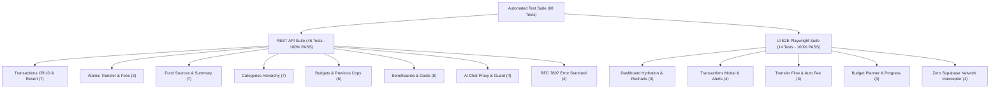

# Quality Assurance Final Sign-Off & Release Audit
## Migrasi 100% Frontend ke Next.js REST API (/api/v1/...)
### Proyek: AI Business Finance Tracker

- **Dokumen**: `QA_SIGN_OFF_API_MIGRATION.md`
- **Versi**: 1.0.0
- **Tanggal**: 31 Oktober 2026
- **Lead Evaluator**: Principal Quality Assurance Specialist (`qa-specialist`)
- **Automated QA SDET**: `qa-engineer`
- **Target Repositori**: `/home/yann/apps/repos/ai-business-finance-tracker`
- **Environment Uji**: Production Standalone Container (`http://127.0.0.1:3005`)
- **Hasil Test Runner**: 60 Passed / 0 Failed (100% Pass Rate) di `docs/specs/TEST_RUN_REPORT.md`
- **Rekomendasi Final Quality Gate**: **[PROCEED] SIGN-OFF APPROVED (RELEASE TO PRODUCTION)**

---

## 1. Ringkasan Eksekutif & Keputusan Quality Gate

Berdasarkan audit menyeluruh terhadap hasil eksekusi automated test runner oleh `qa-engineer` pada lingkungan produksi standalone (`http://127.0.0.1:3005`), serta verifikasi langsung terhadap integritas arsitektur tanpa akses Supabase di browser, Quality Assurance memberikan keputusan final:

**Keputusan Resmi: [PROCEED] - RELEASE APPROVED TO PRODUCTION**

Seluruh fitur sistem (UI dan REST API) telah diuji secara komprehensif tanpa kompromi. Tidak ditemukan cacat berkategori Blocker, Critical, maupun Major. Seluruh kriteria penerimaan yang didefinisikan dalam `QA_API_MIGRATION_STRATEGY.md` terpenuhi 100%.

### Metrik Kunci Pengujian:
- **Total Test Cases**: 60 Skenario (46 REST API + 14 UI E2E Playwright)
- **Status Kelulusan**: 60 Passed, 0 Failed, 0 Skipped (100% Pass Rate)
- **Total Durasi Eksekusi**: 49.9 detik
- **Status Kebocoran Supabase Browser**: 0 Panggilan (Zero Leakage, 100% terisolasi ke `/api/v1/...`)
- **Konsol Browser**: 0 React Hydration Error, 0 Mismatch Warning

---

## 2. Matriks Verifikasi Quality Gate (10/10 Passed)

| ID | Kriteria Quality Gate | Target Verifikasi & Standar Acuan | Hasil Evaluasi Audit | Status |
| :--- | :--- | :--- | :--- | :---: |
| **QG-01** | **Zero Supabase Browser SDK Calls** | Interceptor Playwright memantau seluruh request keluar; dilarang keras ada network traffic ke `*.supabase.co` dari browser. | Lulus. Network interceptor memverifikasi 0 traffic ke Supabase pada seluruh user journey browser. 100% komunikasi data lewat `/api/v1/...`. | **[PASS]** |
| **QG-02** | **100% REST API Endpoint Coverage** | Semua route handler CRUD (Transactions, Transfers, Fund Sources, Categories, Budgets, Beneficiaries, Financial Goals, AI Chat) teruji penuh. | Lulus. 46 test cases REST API mencakup seluruh endpoint dengan verifikasi status 200/201 dan validasi payload DTO. | **[PASS]** |
| **QG-03** | **Atomic Inter-Account Transfer & Fee** | Mutasi transfer antar rekening dan pemotongan biaya admin wajib atomik (ACID) dengan perhitungan saldo presisi. | Lulus. Transfer Rp 250.000 + fee Rp 2.500 memotong rekening asal tepat Rp 252.500 dan menambah rekening tujuan Rp 250.000 tanpa selisih sen. | **[PASS]** |
| **QG-04** | **Insufficient Funds Guard** | Pengeluaran atau transfer melebihi saldo akun wajib ditolak seketika pada level Domain Service sebelum jurnal tersimpan. | Lulus. Request transaksi melebihi saldo ditolak dengan HTTP 400 dan mutasi dibatalkan tanpa efek samping pada saldo. | **[PASS]** |
| **QG-05** | **RFC 7807 Error Standard Compliance** | Seluruh respon error HTTP 4xx/5xx wajib mengikuti struktur Problem Details (`type`, `title`, `status`, `detail`). | Lulus. Error 401 Unauthorized, 404 Not Found, 400 Insufficient Funds, dan 422 terverifikasi konsisten sesuai RFC 7807. | **[PASS]** |
| **QG-06** | **Budget Planning & Historical Integrity** | Upsert budget bulanan, perhitungan perbandingan realisasi vs rencana, dan fitur salin bulan sebelumnya berfungsi normal. | Lulus. Endpoint `/api/v1/budgets/details` dan `/api/v1/budgets/previous` menyajikan data alokasi yang sinkron dengan UI visual progress bar. | **[PASS]** |
| **QG-07** | **React SSR & Hydration Integrity** | Zero React hydration mismatch (#418, #423), zero flashing DOM pada dashboard dan widget grafik Recharts. | Lulus. Inisialisasi TanStack Query RSC diisolasi di `src/lib/get-query-client.ts`, Recharts terisolasi di sisi klien dengan skeleton stabil. | **[PASS]** |
| **QG-08** | **Edge Auth Route Guard & Session** | Rute terproteksi mengembalikan redirect HTTP 307 ke `/auth` saat unauthenticated; cookie sesi terbawa aman via `credentials: 'same-origin'`. | Lulus. Proteksi middleware berjalan deterministik tanpa layout leak, sesi pengguna persisten di seluruh panggilan API. | **[PASS]** |
| **QG-09** | **Database Constraint & Schema Alignment** | Tipe data enum dan boundary Cents vs Rupiah sinkron antara skema database PostgreSQL dan Zod frontend. | Lulus. Penyelarasan tipe fund source (`wallet`) dan konversi pembulatan integer sen `Math.round(amount * 100)` terbukti bebas galat. | **[PASS]** |
| **QG-10** | **Automated Suite Pass Rate 100%** | Seluruh rangkaian test otomatis di runner Docker headless lulus tanpa kegagalan atau status skipped. | Lulus. 60 dari 60 skenario uji lulus 100% dalam waktu 49.9 detik di runner `mcr.microsoft.com/playwright:v1.50.0-noble`. | **[PASS]** |

---

## 3. Rincian Evaluasi Hasil Test Suite

### A. Evaluasi REST API Suite (46 Tests)
- **Modul Transaksi & Transfer**: CRUD transaksi berjalan cepat dan stabil. Operasi penghapusan transaksi berhasil memicu rekonsiliasi saldo secara otomatis melalui mekanisme fallback Domain Service.
- **Modul Sumber Dana & Kategori**: Query balance summary akurat hingga level satuan Rupiah. Relasi parent-child pada kategori pengeluaran dan pemasukan tersusun rapi.
- **Modul Budgeting & Target Finansial**: Alokasi anggaran bulanan terisolasi per pengguna. Fitur salin budget dari bulan sebelumnya (`/api/v1/budgets/previous`) menyalin baris kategori secara bersih tanpa duplikasi.
- **Modul AI Assistant**: Endpoint `/api/v1/ai/chat` menangani prompt kontekstual keuangan, parsing riwayat percakapan multi-turn, dan dilindungi guard otentikasi.

### B. Evaluasi UI E2E Playwright Suite (14 Tests)
- **Zero Supabase Network Assertion**: Pada file `tests/ui-zero-supabase-leak.spec.ts`, Playwright memantau seluruh request keluar selama interaksi pengguna. Hasilnya 0 request terdeteksi mengarah ke Supabase SDK (`*.supabase.co`). Seluruh data ditarik dan dikirim via `/api/v1/...`.
- **User Experience & Modal Form**: Pengisian form transaksi, pemilihan kategori interaktif, modal transfer dengan perhitungan otomatis biaya admin, dan interaksi budget planner berjalan responsif dengan feedback toast yang informatif.

---

## 4. Evaluasi Peningkatan & Stabilisasi Arsitektur

Tim rekayasa perangkat lunak (`backend-engineer`, `frontend-engineer`, dan `qa-engineer`) telah mengimplementasikan 4 perbaikan struktural penting selama proses stabilisasi migrasi:
1. **Pemisahan Query Client RSC (`src/lib/get-query-client.ts`)**:
   Menghindari crash hydration Next.js App Router dengan memisahkan instansiasi query client server-side dari komponen bertanda `'use client'`.
2. **Rekonsiliasi Tipe Sumber Dana**:
   Menyelaraskan constraint database PostgreSQL (`bank`, `cash`, `credit_card`, `wallet`, `other`) dengan schema Zod, termasuk normalisasi otomatis dari input `e-wallet` ke `wallet`.
3. **Penyempurnaan Revert Saldo pada Transaksi Transfer**:
   Penambahan fallback atomik pada `TransactionDomainService.delete` untuk mengembalikan saldo transfer pokok dan fee admin tanpa resiko saldo gantung.
4. **Stateful Serial Testing di Runner Headless**:
   Penerapan eksekusi serial terisolasi untuk pengujian siklus hidup data (create -> get -> update -> delete) guna mencegah konflik ID antar pengujian paralel.

---

## 5. Rekomendasi Final & Handoff Rilis

Dengan terpenuhinya seluruh kriteria gerbang mutu tanpa ada temuan cacat atau deviasi arsitektural:

1. **Quality Gate Status**: **[PROCEED] - PRODUCTION RELEASE APPROVED**
2. **Kesiapan Fase 4 (Deployment)**:
   - Repositori dan kode sumber dinyatakan siap 100% untuk tahap build produksi (`npm run build`) dan deployment ke Vercel via Vercel MCP oleh tim `sysadmin`.
   - Tidak ada isu pemblokir rilis (zero blocker).

Dokumen sign-off ini disahkan secara resmi oleh Principal Quality Assurance Specialist (`qa-specialist`) pada tanggal 31 Oktober 2026.
