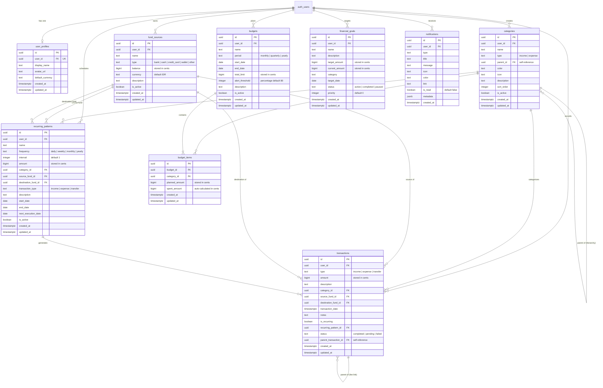

# 🗄️ Database Schema & RPC Functions Reference Manual

> **Single Source of Truth (SSOT)** for AI Business Finance Tracker Database Architecture.  
> Seluruh skema tabel, fungsi Remote Procedure Calls (RPC), database triggers, relasi relasional, dan kebijakan Row-Level Security (RLS) diatur dan didokumentasikan di sini sebagai acuan utama sistem backend dan sinkronisasi frontend.

---

## Metadata Dokumen

| Parameter | Spesifikasi |
| :--- | :--- |
| **Status Dokumen** | **Production Ready / Verified** |
| **Database Engine** | PostgreSQL 15+ (Hosted on Supabase) |
| **Supabase Project ID** | `nfvjwkimzlqszwpydees` |
| **Target Schema** | `public` |
| **Identity / Auth Provider**| `auth.users` (Supabase GoTrue) |
| **Monetary Convention** | Integer Cents (`bigint`) — Bebas dari pembulatan floating-point IEEE 754 |
| **Terakhir Diverifikasi** | 2026-10-23 |

---

## Daftar Isi

1. [Schema Overview & Core Design Principles](#1-schema-overview--core-design-principles)
2. [Complete Entity Relationship Diagram (ERD)](#2-complete-entity-relationship-diagram-erd)
3. [Table Definitions & Data Dictionary](#3-table-definitions--data-dictionary)
   - 3.1 [`user_profiles`](#31-user_profiles-user-extended-profile)
   - 3.2 [`fund_sources`](#32-fund_sources-accounts-wallets--cards)
   - 3.3 [`categories`](#33-categories-hierarchical-financial-taxonomy)
   - 3.4 [`transactions`](#34-transactions-double-entry-financial-ledger)
   - 3.5 [`budgets`](#35-budgets-periodic-spending-caps)
   - 3.6 [`budget_items`](#36-budget_items-category-budget-allocations)
   - 3.7 [`recurring_patterns`](#37-recurring_patterns-scheduled-automations)
   - 3.8 [`financial_goals`](#38-financial_goals-saving-targets--milestones)
   - 3.9 [`notifications`](#39-notifications-system--budget-alerts)
4. [Database Functions (RPC) & Automated Triggers](#4-database-functions-rpc--automated-triggers)
   - 4.1 [Compatibility RPCs (Frontend Standard API)](#41-compatibility-rpcs-frontend-standard-api)
   - 4.2 [Native Ledger & Mutation RPCs](#42-native-ledger--mutation-rpcs)
   - 4.3 [Budget Planning & Calculation RPCs](#43-budget-planning--calculation-rpcs)
   - 4.4 [Dashboard & Analytics Aggregation RPCs](#44-dashboard--analytics-aggregation-rpcs)
   - 4.5 [Notification Management RPCs](#45-notification-management-rpcs)
   - 4.6 [Automated Database Triggers Engine](#46-automated-database-triggers-engine)
5. [Row-Level Security (RLS) Governance](#5-row-level-security-rls-governance)
   - 5.1 [RLS Security Matrix](#51-rls-security-matrix)
   - 5.2 [Detail Kebijakan Keamanan per Tabel](#52-detail-kebijakan-keamanan-per-tabel)
6. [Performance & Indexing Strategy](#6-performance--indexing-strategy)
7. [Realtime & Seed Data Initialization](#7-realtime--seed-data-initialization)

---

## 1. Schema Overview & Core Design Principles

Arsitektur database **AI Business Finance Tracker** dirancang menggunakan prinsip relational ledger ketat, atomic balance updates, dan granular multi-tenancy.

### 1.1 Prinsip Desain Fundamental

1. **Integer Cents Representation (`bigint`)**:
   - Seluruh nilai nominal uang disimpan dalam satuan terkecil (cents / sen / rupiah utuh) bertipe `bigint`.
   - Menghindari bug fatal pembulatan pecahan IEEE 754 (mis. `0.1 + 0.2 = 0.30000000000000004`).
   - Format: `Rp 50.000,00` disimpan sebagai `5000000` (atau integer murni sesuai scale mata uang).
2. **Strict Multi-Tenancy via Row-Level Security (RLS)**:
   - Setiap tabel memiliki kolom `user_id uuid REFERENCES auth.users(id)` (atau mewarisi filter dari tabel induknya).
   - Akses client-side (Supabase anon key) hanya dapat mengakses baris milik pengguna yang terautentikasi (`auth.uid() = user_id`).
3. **Atomic Balance Updates via Database Functions (RPC)**:
   - Perubahan saldo akun tidak pernah diizinkan dilakukan langsung melalui manipulasi client-side `fund_sources.balance`.
   - Pembuatan, pembaruan, dan pembatalan transaksi wajib melalui PL/pgSQL RPC Functions berstatus `SECURITY DEFINER` yang membungkus mutasi tabel `transactions` dan tabel `fund_sources` ke dalam satu transaksi atomik PostgreSQL (ACID).
4. **Parent-Child Fee Linking**:
   - Transaksi transfer yang mengenakan biaya admin mencatat baris transaksi fee terpisah yang mengaitkan `parent_transaction_id` ke transaksi transfer induknya dengan relasi `ON DELETE CASCADE / SET NULL`.
5. **Reactive Trigger-Based Tracking**:
   - Modifikasi transaksi secara otomatis memicu trigger `update_budget_spent_amount` untuk memperbarui kalkulasi `spent_amount` pada periode budget aktif tanpa intervensi manual klien.

### 1.2 Inventaris Tabel & Pengelompokan Domain

| Domain | Tabel | Deskripsi |
| :--- | :--- | :--- |
| **Auth & Identity** | [`user_profiles`](#31-user_profiles-user-extended-profile) | Data profil pengguna terikat dengan Supabase Auth |
| **Financial Structures**| [`fund_sources`](#32-fund_sources-accounts-wallets--cards) | Akun dompet, rekening bank, kartu kredit, dan kas tunai |
| | [`categories`](#33-categories-hierarchical-financial-taxonomy) | Taksonomi hierarkis pendapatan dan pengeluaran |
| **Journal Ledger** | [`transactions`](#34-transactions-double-entry-financial-ledger) | Catatan mutasi debit/kredit dan transfer saldo |
| | [`recurring_patterns`](#37-recurring_patterns-scheduled-automations) | Pola transaksi berkala / langganan terjadwal |
| **Budget & Goals** | [`budgets`](#35-budgets-periodic-spending-caps) | Batas plafon pengeluaran per periode waktu |
| | [`budget_items`](#36-budget_items-category-budget-allocations) | Rincian alokasi nominal per kategori dalam suatu budget |
| | [`financial_goals`](#38-financial_goals-saving-targets--milestones) | Target capaian tabungan atau aset finansial |
| **Alerts & Realtime** | [`notifications`](#39-notifications-system--budget-alerts) | Pusat notifikasi aktivitas, limit budget, dan saldo |

---

## 2. Complete Entity Relationship Diagram (ERD)



---

## 3. Table Definitions & Data Dictionary

### 3.1 `user_profiles` (User Extended Profile)

Tabel ini menyimpan metadata profil pengguna yang terkait langsung dengan akun `auth.users` Supabase. Dibuat secara otomatis saat pengguna mendaftar melalui trigger `handle_new_user`.

#### DDL Definition
```sql
CREATE TABLE public.user_profiles (
    id UUID PRIMARY KEY DEFAULT gen_random_uuid(),
    user_id UUID NOT NULL REFERENCES auth.users(id) ON DELETE CASCADE,
    display_name TEXT,
    avatar_url TEXT,
    default_currency TEXT DEFAULT 'IDR'::text,
    created_at TIMESTAMP WITH TIME ZONE NOT NULL DEFAULT now(),
    updated_at TIMESTAMP WITH TIME ZONE NOT NULL DEFAULT now(),
    CONSTRAINT user_profiles_user_id_key UNIQUE (user_id)
);
```

#### Kamus Data
| Kolom | Tipe Data | Nullable | Default | Deskripsi |
| :--- | :--- | :--- | :--- | :--- |
| `id` | `uuid` | NO | `gen_random_uuid()` | Primary key internal profile |
| `user_id` | `uuid` | NO | - | Foreign key ke `auth.users(id)` (Unique 1-to-1) |
| `display_name` | `text` | YES | `NULL` | Nama lengkap atau nama tampilan pengguna |
| `avatar_url` | `text` | YES | `NULL` | URI avatar foto profil pengguna |
| `default_currency` | `text` | YES | `'IDR'` | Mata uang default akun (mis. `'IDR'`, `'USD'`) |
| `created_at` | `timestamptz`| NO | `now()` | Waktu profil dibuat |
| `updated_at` | `timestamptz`| NO | `now()` | Waktu pembaruan profil terakhir |

---

### 3.2 `fund_sources` (Accounts, Wallets & Cards)

Menyimpan sumber dana keuangan pengguna seperti rekening bank, dompet digital, kartu kredit, dan kas tunai.

#### DDL Definition
```sql
CREATE TABLE public.fund_sources (
    id UUID PRIMARY KEY DEFAULT gen_random_uuid(),
    user_id UUID NOT NULL REFERENCES auth.users(id) ON DELETE CASCADE,
    name TEXT NOT NULL,
    type TEXT NOT NULL CHECK (type IN ('bank', 'cash', 'credit_card', 'wallet', 'other')),
    balance BIGINT NOT NULL DEFAULT 0,
    currency TEXT NOT NULL DEFAULT 'IDR'::text,
    description TEXT,
    is_active BOOLEAN NOT NULL DEFAULT true,
    created_at TIMESTAMP WITH TIME ZONE NOT NULL DEFAULT now(),
    updated_at TIMESTAMP WITH TIME ZONE NOT NULL DEFAULT now()
);
```

#### Kamus Data
| Kolom | Tipe Data | Nullable | Default | Deskripsi |
| :--- | :--- | :--- | :--- | :--- |
| `id` | `uuid` | NO | `gen_random_uuid()` | Primary key sumber dana |
| `user_id` | `uuid` | NO | - | Pemilik akun, FK ke `auth.users(id)` |
| `name` | `text` | NO | - | Nama rekening/dompet (mis. `"BCA Bisnis"`, `"GoPay"`, `"Kas Tunai"`) |
| `type` | `text` | NO | - | Tipe instrumen: `'bank'`, `'cash'`, `'credit_card'`, `'wallet'`, `'other'` |
| `balance` | `bigint` | NO | `0` | **Saldo terkini dalam satuan cents**. Wajib diubah via RPC |
| `currency` | `text` | NO | `'IDR'` | Kode ISO mata uang akun |
| `description`| `text` | YES | `NULL` | Catatan opsional nomor rekening atau institusi |
| `is_active` | `boolean` | NO | `true` | Status keaktifan sumber dana |
| `created_at` | `timestamptz`| NO | `now()` | Waktu pembuatan akun |
| `updated_at` | `timestamptz`| NO | `now()` | Waktu update terakhir |

---

### 3.3 `categories` (Hierarchical Financial Taxonomy)

Menyimpan kategori transaksi pendapatan (`income`) dan pengeluaran (`expense`). Mendukung struktur hierarkis (induk-anak) melalui kolom `parent_id`.

#### DDL Definition
```sql
CREATE TABLE public.categories (
    id UUID PRIMARY KEY DEFAULT gen_random_uuid(),
    user_id UUID NOT NULL REFERENCES auth.users(id) ON DELETE CASCADE,
    name TEXT NOT NULL,
    type TEXT NOT NULL CHECK (type IN ('income', 'expense')),
    parent_id UUID REFERENCES public.categories(id) ON DELETE SET NULL,
    color TEXT,
    icon TEXT,
    description TEXT,
    sort_order INTEGER,
    is_active BOOLEAN NOT NULL DEFAULT true,
    created_at TIMESTAMP WITH TIME ZONE NOT NULL DEFAULT now(),
    updated_at TIMESTAMP WITH TIME ZONE NOT NULL DEFAULT now(),
    CONSTRAINT categories_user_type_name_unique UNIQUE (user_id, type, name)
);
```

#### Kamus Data
| Kolom | Tipe Data | Nullable | Default | Deskripsi |
| :--- | :--- | :--- | :--- | :--- |
| `id` | `uuid` | NO | `gen_random_uuid()` | Primary key kategori |
| `user_id` | `uuid` | NO | - | Pemilik kategori, FK ke `auth.users(id)` |
| `name` | `text` | NO | - | Nama kategori (mis. `"Operasional"`, `"Gaji"`, `"Pemasaran"`) |
| `type` | `text` | NO | - | Aliran kategori: `'income'` atau `'expense'` |
| `parent_id` | `uuid` | YES | `NULL` | Kategori induk jika bertindak sebagai sub-kategori |
| `color` | `text` | YES | `NULL` | Kode hex warna antarmuka (mis. `"#3B82F6"`) |
| `icon` | `text` | YES | `NULL` | Identifier icon (mis. `"briefcase"`, `"shopping-cart"`) |
| `description`| `text` | YES | `NULL` | Deskripsi fungsional kategori |
| `sort_order` | `integer` | YES | `NULL` | Urutan penataan visual di antarmuka |
| `is_active` | `boolean` | NO | `true` | Status ketersediaan kategori |
| `created_at` | `timestamptz`| NO | `now()` | Waktu pembuatan |
| `updated_at` | `timestamptz`| NO | `now()` | Waktu modifikasi terakhir |

---

### 3.4 `transactions` (Double-Entry Financial Ledger)

Tabel sentral pembukuan yang mencatat setiap arus perpindahan uang.

#### DDL Definition
```sql
CREATE TABLE public.transactions (
    id UUID PRIMARY KEY DEFAULT gen_random_uuid(),
    user_id UUID NOT NULL REFERENCES auth.users(id) ON DELETE CASCADE,
    type TEXT NOT NULL CHECK (type IN ('income', 'expense', 'transfer')),
    amount BIGINT NOT NULL CHECK (amount > 0),
    description TEXT,
    category_id UUID REFERENCES public.categories(id) ON DELETE SET NULL,
    source_fund_id UUID REFERENCES public.fund_sources(id) ON DELETE RESTRICT,
    destination_fund_id UUID REFERENCES public.fund_sources(id) ON DELETE RESTRICT,
    transaction_date TIMESTAMP WITH TIME ZONE NOT NULL,
    notes TEXT,
    is_recurring BOOLEAN NOT NULL DEFAULT false,
    recurring_pattern_id UUID REFERENCES public.recurring_patterns(id) ON DELETE SET NULL,
    status TEXT NOT NULL DEFAULT 'completed'::text CHECK (status IN ('completed', 'pending', 'failed')),
    parent_transaction_id UUID REFERENCES public.transactions(id) ON DELETE CASCADE,
    created_at TIMESTAMP WITH TIME ZONE NOT NULL DEFAULT now(),
    updated_at TIMESTAMP WITH TIME ZONE NOT NULL DEFAULT now()
);
```

#### Aturan Logika Kolom Sesuai Tipe Transaksi
- **`income`**: Memerlukan `destination_fund_id` (dana masuk) dan `category_id` (kategori income). Kolom `source_fund_id` bernilai `NULL`.
- **`expense`**: Memerlukan `source_fund_id` (dana keluar) dan `category_id` (kategori expense). Kolom `destination_fund_id` bernilai `NULL`.
- **`transfer`**: Memerlukan kedua `source_fund_id` (asal) dan `destination_fund_id` (tujuan). Kolom `category_id` bernilai `NULL`.

#### Kamus Data
| Kolom | Tipe Data | Nullable | Default | Deskripsi |
| :--- | :--- | :--- | :--- | :--- |
| `id` | `uuid` | NO | `gen_random_uuid()` | Primary key transaksi |
| `user_id` | `uuid` | NO | - | Pemilik transaksi, FK ke `auth.users(id)` |
| `type` | `text` | NO | - | Jenis: `'income'`, `'expense'`, atau `'transfer'` |
| `amount` | `bigint` | NO | - | **Nilai transaksi dalam cents** (harus > 0) |
| `description` | `text` | YES | `NULL` | Ringkasan/keterangan singkat transaksi |
| `category_id` | `uuid` | YES | `NULL` | FK ke `categories(id)` |
| `source_fund_id` | `uuid` | YES | `NULL` | Akun asal dana, FK ke `fund_sources(id)` |
| `destination_fund_id` | `uuid` | YES | `NULL` | Akun tujuan dana, FK ke `fund_sources(id)` |
| `transaction_date` | `timestamptz` | NO | - | Tanggal efektif pembukuan transaksi |
| `notes` | `text` | YES | `NULL` | Catatan tambahan mendalam / bukti transaksi |
| `is_recurring` | `boolean` | NO | `false` | Apakah transaksi dibangkitkan dari langganan berkala |
| `recurring_pattern_id`| `uuid` | YES | `NULL` | FK ke `recurring_patterns(id)` bila otomatis |
| `status` | `text` | NO | `'completed'`| Status eksekusi (`completed`, `pending`, `failed`) |
| `parent_transaction_id`| `uuid` | YES | `NULL` | FK ke transaksi induk (misal: baris admin fee terikat transfer) |
| `created_at` | `timestamptz` | NO | `now()` | Waktu transaksi dibuat di database |
| `updated_at` | `timestamptz` | NO | `now()` | Waktu transaksi diperbarui |

---

### 3.5 `budgets` (Periodic Spending Caps)

Mendefinisikan pagu anggaran per jangka waktu (bulanan, kuartalan, atau tahunan).

#### DDL Definition
```sql
CREATE TABLE public.budgets (
    id UUID PRIMARY KEY DEFAULT gen_random_uuid(),
    user_id UUID NOT NULL REFERENCES auth.users(id) ON DELETE CASCADE,
    name TEXT NOT NULL,
    period TEXT NOT NULL CHECK (period IN ('monthly', 'quarterly', 'yearly')),
    start_date DATE NOT NULL,
    end_date DATE NOT NULL,
    total_limit BIGINT NOT NULL CHECK (total_limit > 0),
    alert_threshold INTEGER NOT NULL DEFAULT 80 CHECK (alert_threshold BETWEEN 1 AND 100),
    description TEXT,
    is_active BOOLEAN NOT NULL DEFAULT true,
    created_at TIMESTAMP WITH TIME ZONE NOT NULL DEFAULT now(),
    updated_at TIMESTAMP WITH TIME ZONE NOT NULL DEFAULT now()
);
```

#### Kamus Data
| Kolom | Tipe Data | Nullable | Default | Deskripsi |
| :--- | :--- | :--- | :--- | :--- |
| `id` | `uuid` | NO | `gen_random_uuid()` | Primary key budget |
| `user_id` | `uuid` | NO | - | Pemilik budget, FK ke `auth.users(id)` |
| `name` | `text` | NO | - | Nama budget (mis. `"Anggaran Operasional Oktober 2026"`) |
| `period` | `text` | NO | - | Durasi: `'monthly'`, `'quarterly'`, atau `'yearly'` |
| `start_date` | `date` | NO | - | Tanggal awal berlakunya budget |
| `end_date` | `date` | NO | - | Tanggal akhir periode budget |
| `total_limit` | `bigint` | NO | - | **Batas total pagu anggaran dalam cents** |
| `alert_threshold` | `integer` | NO | `80` | Batas persentase picu notifikasi (mis. 80%) |
| `description` | `text` | YES | `NULL` | Penjelasan objektif budget |
| `is_active` | `boolean` | NO | `true` | Status keaktifan budget |
| `created_at` | `timestamptz` | NO | `now()` | Waktu pembuatan |
| `updated_at` | `timestamptz` | NO | `now()` | Waktu pembaruan |

---

### 3.6 `budget_items` (Category Budget Allocations)

Rincian alokasi anggaran per masing-masing kategori belanja dalam budget terkait.

#### DDL Definition
```sql
CREATE TABLE public.budget_items (
    id UUID PRIMARY KEY DEFAULT gen_random_uuid(),
    budget_id UUID NOT NULL REFERENCES public.budgets(id) ON DELETE CASCADE,
    category_id UUID NOT NULL REFERENCES public.categories(id) ON DELETE CASCADE,
    planned_amount BIGINT NOT NULL CHECK (planned_amount >= 0),
    spent_amount BIGINT NOT NULL DEFAULT 0,
    created_at TIMESTAMP WITH TIME ZONE NOT NULL DEFAULT now(),
    updated_at TIMESTAMP WITH TIME ZONE NOT NULL DEFAULT now(),
    CONSTRAINT budget_items_budget_category_unique UNIQUE (budget_id, category_id)
);
```

#### Kamus Data
| Kolom | Tipe Data | Nullable | Default | Deskripsi |
| :--- | :--- | :--- | :--- | :--- |
| `id` | `uuid` | NO | `gen_random_uuid()` | Primary key alokasi budget |
| `budget_id` | `uuid` | NO | - | FK ke `budgets(id)` dengan cascade delete |
| `category_id` | `uuid` | NO | - | FK ke `categories(id)` |
| `planned_amount` | `bigint` | NO | - | **Nominal rencana anggaran dalam cents** |
| `spent_amount` | `bigint` | NO | `0` | **Akumulasi pengeluaran nyata dalam cents** (dihitung otomatis via trigger) |
| `created_at` | `timestamptz` | NO | `now()` | Waktu pembuatan |
| `updated_at` | `timestamptz` | NO | `now()` | Waktu modifikasi terakhir |

---

### 3.7 `recurring_patterns` (Scheduled Automations)

Menyimpan konfigurasi transaksi berulang seperti tagihan bulanan, sewa server, langganan SaaS, atau cicilan.

#### DDL Definition
```sql
CREATE TABLE public.recurring_patterns (
    id UUID PRIMARY KEY DEFAULT gen_random_uuid(),
    user_id UUID NOT NULL REFERENCES auth.users(id) ON DELETE CASCADE,
    name TEXT NOT NULL,
    frequency TEXT NOT NULL CHECK (frequency IN ('daily', 'weekly', 'monthly', 'yearly')),
    interval INTEGER NOT NULL DEFAULT 1 CHECK (interval > 0),
    amount BIGINT NOT NULL CHECK (amount > 0),
    category_id UUID REFERENCES public.categories(id) ON DELETE SET NULL,
    source_fund_id UUID REFERENCES public.fund_sources(id) ON DELETE SET NULL,
    destination_fund_id UUID REFERENCES public.fund_sources(id) ON DELETE SET NULL,
    transaction_type TEXT NOT NULL CHECK (transaction_type IN ('income', 'expense', 'transfer')),
    description TEXT,
    start_date DATE NOT NULL,
    end_date DATE,
    next_execution_date DATE NOT NULL,
    is_active BOOLEAN NOT NULL DEFAULT true,
    created_at TIMESTAMP WITH TIME ZONE NOT NULL DEFAULT now(),
    updated_at TIMESTAMP WITH TIME ZONE NOT NULL DEFAULT now()
);
```

#### Kamus Data
| Kolom | Tipe Data | Nullable | Default | Deskripsi |
| :--- | :--- | :--- | :--- | :--- |
| `id` | `uuid` | NO | `gen_random_uuid()` | Primary key recurring pattern |
| `user_id` | `uuid` | NO | - | Pemilik konfigurasi, FK ke `auth.users(id)` |
| `name` | `text` | NO | - | Nama pengulangan (mis. `"Langganan Cloud AWS"`) |
| `frequency` | `text` | NO | - | Periode: `'daily'`, `'weekly'`, `'monthly'`, `'yearly'` |
| `interval` | `integer` | NO | `1` | Interval frekuensi (mis. setiap 2 bulan jika interval = 2) |
| `amount` | `bigint` | NO | - | **Nominal berulang dalam cents** |
| `category_id` | `uuid` | YES | `NULL` | Kategori terkait |
| `source_fund_id`| `uuid` | YES | `NULL` | Akun sumber dana |
| `destination_fund_id`| `uuid` | YES | `NULL` | Akun tujuan dana |
| `transaction_type` | `text`| NO | - | Jenis: `'income'`, `'expense'`, atau `'transfer'` |
| `description` | `text` | YES | `NULL` | Deskripsi transaksi |
| `start_date` | `date` | NO | - | Tanggal awal penjadwalan |
| `end_date` | `date` | YES | `NULL` | Batas akhir jadwal (NULL jika selamanya) |
| `next_execution_date` | `date` | NO | - | Tanggal eksekusi transaksi berikutnya |
| `is_active` | `boolean` | NO | `true` | Status keaktifan otomatisasi |
| `created_at` | `timestamptz`| NO | `now()` | Waktu pembuatan |
| `updated_at` | `timestamptz`| NO | `now()` | Waktu pembaruan |

---

### 3.8 `financial_goals` (Saving Targets & Milestones)

Menyimpan target finansial masa depan seperti dana darurat, ekspansi bisnis, atau pembelian inventaris aset.

#### DDL Definition
```sql
CREATE TABLE public.financial_goals (
    id UUID PRIMARY KEY DEFAULT gen_random_uuid(),
    user_id UUID NOT NULL REFERENCES auth.users(id) ON DELETE CASCADE,
    name TEXT NOT NULL,
    description TEXT,
    target_amount BIGINT NOT NULL CHECK (target_amount > 0),
    current_amount BIGINT NOT NULL DEFAULT 0 CHECK (current_amount >= 0),
    category TEXT NOT NULL,
    target_date DATE NOT NULL,
    status TEXT NOT NULL DEFAULT 'active'::text CHECK (status IN ('active', 'completed', 'paused')),
    priority INTEGER DEFAULT 0,
    created_at TIMESTAMP WITH TIME ZONE NOT NULL DEFAULT now(),
    updated_at TIMESTAMP WITH TIME ZONE NOT NULL DEFAULT now()
);
```

#### Kamus Data
| Kolom | Tipe Data | Nullable | Default | Deskripsi |
| :--- | :--- | :--- | :--- | :--- |
| `id` | `uuid` | NO | `gen_random_uuid()` | Primary key target keuangan |
| `user_id` | `uuid` | NO | - | Pemilik target, FK ke `auth.users(id)` |
| `name` | `text` | NO | - | Judul target (mis. `"Dana Cadangan Modal Kerja"`) |
| `description` | `text` | YES | `NULL` | Keterangan tujuan |
| `target_amount`| `bigint` | NO | - | **Batas nominal sasaran dalam cents** |
| `current_amount`| `bigint` | NO | `0` | **Progres capaian tabungan dalam cents** |
| `category` | `text` | NO | - | Kategori sasaran (mis. `"Emergency"`, `"Investment"`) |
| `target_date` | `date` | NO | - | Tenggat waktu pencapaian target |
| `status` | `text` | NO | `'active'` | Status: `'active'`, `'completed'`, `'paused'` |
| `priority` | `integer`| YES | `0` | Skala prioritas (makin tinggi makin diprioritaskan) |
| `created_at` | `timestamptz`| NO | `now()` | Waktu pembuatan |
| `updated_at` | `timestamptz`| NO | `now()` | Waktu pembaruan |

---

### 3.9 `notifications` (System & Budget Alerts)

Menyimpan pemberitahuan in-app bagi pengguna terkait peringatan over-budget, saldo menipis, atau milestone tabungan.

#### DDL Definition
```sql
CREATE TABLE public.notifications (
    id UUID PRIMARY KEY DEFAULT gen_random_uuid(),
    user_id UUID NOT NULL REFERENCES auth.users(id) ON DELETE CASCADE,
    type TEXT NOT NULL,
    title TEXT NOT NULL,
    message TEXT NOT NULL,
    icon TEXT DEFAULT 'i-lucide-bell'::text,
    color TEXT DEFAULT 'primary'::text,
    link TEXT,
    is_read BOOLEAN DEFAULT false,
    metadata JSONB DEFAULT '{}'::jsonb,
    created_at TIMESTAMP WITH TIME ZONE DEFAULT now()
);
```

#### Kamus Data
| Kolom | Tipe Data | Nullable | Default | Deskripsi |
| :--- | :--- | :--- | :--- | :--- |
| `id` | `uuid` | NO | `gen_random_uuid()` | Primary key notifikasi |
| `user_id` | `uuid` | NO | - | Penerima notifikasi, FK ke `auth.users(id)` |
| `type` | `text` | NO | - | Tipe pesan (mis. `'budget_alert'`, `'low_balance'`, `'milestone'`) |
| `title` | `text` | NO | - | Judul singkat notifikasi |
| `message` | `text` | NO | - | Isi pesan lengkap |
| `icon` | `text` | YES | `'i-lucide-bell'` | Identifier icon visual |
| `color` | `text` | YES | `'primary'` | Penanda warna alert (`warning`, `danger`, `success`) |
| `link` | `text` | YES | `NULL` | URL / rute navigasi aplikasi saat diklik |
| `is_read` | `boolean` | YES | `false` | Status terbaca oleh pengguna |
| `metadata` | `jsonb` | YES | `'{}'` | Payload JSON opsional (id budget, id transaksi, dsb.) |
| `created_at` | `timestamptz`| YES | `now()` | Waktu notifikasi dipancarkan |

---

## 4. Database Functions (RPC) & Automated Triggers

Database menggunakan PL/pgSQL functions untuk memastikan mutasi data yang aman, berintegritas tinggi, dan tidak memicu kondisi balapan (*race condition*).

### 4.1 Compatibility RPCs (Frontend Standard API)

Fungsi kompatibilitas ini dipanggil langsung oleh modul frontend client Supabase (`src/lib/storage.ts` dan hooks).

#### 1. `create_transaction_and_update_balance`
- **Tujuan**: Membuat transaksi baru, menangani biaya transfer (jika ada), dan memperbarui saldo rekening secara atomik.
- **Security**: `SECURITY DEFINER`
- **Signature**:
  ```sql
  create_transaction_and_update_balance(
      p_description TEXT,
      p_amount BIGINT,
      p_type TEXT,
      p_transaction_date TIMESTAMPTZ,
      p_user_id UUID,
      p_category_id UUID,
      p_source_fund_id UUID,
      p_destination_fund_id UUID,
      p_fee BIGINT
  ) RETURNS JSONB
  ```
- **Logika Eksekusi**:
  1. Validasi saldo rekening `source_fund_id` apakah mencukupi jika tipe adalah `expense` atau `transfer`.
  2. Masukkan baris transaksi utama ke tabel `transactions`.
  3. Jika `p_type = 'transfer'` dan `p_fee > 0`, masukkan baris transaksi tambahan berjenis `expense` sebesar `p_fee` dengan kolom `parent_transaction_id` mengarah ke transaksi utama.
  4. Perbarui saldo pada `fund_sources`:
     - `expense`: Kurangi `p_amount` dari saldo sumber.
     - `income`: Tambahkan `p_amount` ke saldo tujuan.
     - `transfer`: Kurangi `p_amount + COALESCE(p_fee, 0)` dari sumber dan tambahkan `p_amount` ke tujuan.
  5. Mengembalikan row transaksi baru dalam format JSON.

#### 2. `update_transaction_and_update_balance`
- **Tujuan**: Mengubah data transaksi yang sudah ada dengan membalikkan (*revert*) dampak transaksi lama terlebih dahulu, lalu menerapkan dampak saldo baru.
- **Security**: `SECURITY DEFINER`
- **Signature**:
  ```sql
  update_transaction_and_update_balance(
      p_id UUID,
      p_description TEXT,
      p_amount BIGINT,
      p_type TEXT,
      p_transaction_date TIMESTAMPTZ,
      p_category_id UUID,
      p_source_fund_id UUID,
      p_destination_fund_id UUID,
      p_fee BIGINT
  ) RETURNS VOID
  ```
- **Logika Eksekusi**:
  1. Ambil data transaksi lama dari database berdasarkan `p_id`.
  2. Revert saldo `fund_sources` yang terdampak oleh transaksi lama dan biaya admin terkait.
  3. Lakukan update data baris transaksi utama.
  4. Terapkan saldo baru ke rekening terkait.

#### 3. `delete_transaction_and_revert_balance`
- **Tujuan**: Menghapus transaksi, menghapus biaya anak terkait (*cascade fee*), dan mengembalikan saldo rekening ke kondisi semula.
- **Security**: `SECURITY DEFINER`
- **Signature**:
  ```sql
  delete_transaction_and_revert_balance(
      p_transaction_id UUID
  ) RETURNS VOID
  ```
- **Logika Eksekusi**:
  1. Identifikasi transaksi yang akan dihapus beserta anak transaksi biaya (`parent_transaction_id = p_transaction_id`).
  2. Kembalikan saldo (*revert balance*) pada akun sumber maupun tujuan.
  3. Hapus baris transaksi biaya (jika ada) dan hapus transaksi utama.

#### 4. `get_or_create_budget_for_month`
- **Tujuan**: Mengambil budget aktif untuk bulan kalender tertentu atau membuatkan budget default baru jika belum tersedia.
- **Security**: `SECURITY DEFINER`
- **Signature**:
  ```sql
  get_or_create_budget_for_month(
      p_user_id UUID,
      p_month_date DATE
  ) RETURNS TABLE(
      id UUID,
      user_id UUID,
      name TEXT,
      start_date DATE,
      end_date DATE,
      created_at TIMESTAMPTZ
  )
  ```

#### 5. `upsert_budget_with_items`
- **Tujuan**: Menyimpan atau memperbarui dokumen pagu anggaran beserta seluruh rincian alokasi per kategori (`budget_items`) dalam satu transaksi atomik.
- **Security**: `SECURITY DEFINER`
- **Signature**:
  ```sql
  upsert_budget_with_items(
      p_user_id UUID,
      p_start_date DATE,
      p_end_date DATE,
      p_name TEXT,
      p_items JSONB
  ) RETURNS VOID
  ```

#### 6. `get_budget_details`
- **Tujuan**: Mengambil seluruh daftar alokasi kategori beserta perbandingan nilai rencana vs realisasi pengeluaran (`spent`).
- **Signature**:
  ```sql
  get_budget_details(
      p_budget_id UUID
  ) RETURNS TABLE(
      id UUID,
      amount BIGINT,
      category_id UUID,
      category_name TEXT,
      category_icon TEXT,
      spent BIGINT
  )
  ```

---

### 4.2 Native Ledger & Mutation RPCs

Fungsi tingkat lanjut native database yang digunakan untuk mutasi dan penyesuaian saldo.

- **`create_transaction_with_balance_update`**:
  ```sql
  create_transaction_with_balance_update(
      p_type TEXT,
      p_amount BIGINT,
      p_description TEXT,
      p_category_id UUID,
      p_source_fund_id UUID,
      p_destination_fund_id UUID,
      p_transaction_date TIMESTAMPTZ,
      p_notes TEXT,
      p_recurring_pattern_id UUID
  ) RETURNS transactions
  ```
- **`update_transaction_with_balance_adjustment`**:
  ```sql
  update_transaction_with_balance_adjustment(
      p_transaction_id UUID,
      p_amount BIGINT,
      p_source_fund_id UUID,
      p_destination_fund_id UUID,
      p_transaction_date TIMESTAMPTZ,
      p_description TEXT,
      p_category_id UUID,
      p_notes TEXT
  ) RETURNS transactions
  ```
- **`delete_transaction_with_balance_adjustment`**:
  ```sql
  delete_transaction_with_balance_adjustment(p_transaction_id UUID) RETURNS BOOLEAN
  ```

---

### 4.3 Budget Planning & Calculation RPCs

- **`get_budget_spending_details`**:
  ```sql
  get_budget_spending_details(p_budget_id UUID)
  RETURNS TABLE(
      category_id UUID,
      category_name TEXT,
      planned_amount BIGINT,
      spent_amount BIGINT,
      percentage INTEGER,
      status TEXT
  )
  ```
- **`get_budget_spending_summary`**:
  ```sql
  get_budget_spending_summary(p_budget_id UUID)
  RETURNS TABLE(
      category_id UUID,
      category_name TEXT,
      planned_amount BIGINT,
      spent_amount BIGINT,
      remaining_amount BIGINT,
      percentage_used NUMERIC
  )
  ```
- **`recalculate_all_budget_spent_amounts()`**: Menghitung ulang seluruh `spent_amount` pada semua `budget_items` dari histori transaksi.
- **`refresh_budget_spending(p_budget_id UUID)`**: Menghitung ulang alokasi pengeluaran pada satu budget spesifik.

---

### 4.4 Dashboard & Analytics Aggregation RPCs

- **`get_dashboard_summary()`**:
  Mengembalikan metrik finansial global pengguna yang sedang login dalam sekali query efisien:
  ```sql
  get_dashboard_summary()
  RETURNS TABLE(
      total_balance BIGINT,
      total_income BIGINT,
      total_expense BIGINT,
      net_flow BIGINT,
      active_budgets_count INTEGER,
      active_goals_count INTEGER,
      fund_sources_count INTEGER
  )
  ```
- **`get_monthly_spending(p_year INTEGER, p_month INTEGER)`**:
  Mengagregasi total pengeluaran per kategori untuk laporan bulanan.
  ```sql
  get_monthly_spending(p_year INTEGER, p_month INTEGER)
  RETURNS TABLE(
      category_id UUID,
      category_name TEXT,
      category_type TEXT,
      total_amount BIGINT,
      transaction_count INTEGER
  )
  ```
- **`get_goals_with_progress()`**:
  Menghitung persentase progres dan estimasi sisa hari pencapaian setiap target tabungan:
  ```sql
  get_goals_with_progress()
  RETURNS TABLE(
      goal_id UUID,
      goal_name TEXT,
      target_amount BIGINT,
      current_amount BIGINT,
      target_date DATE,
      days_remaining INTEGER,
      progress_percentage INTEGER,
      status TEXT,
      is_on_track BOOLEAN
  )
  ```

---

### 4.5 Notification Management RPCs

- **`create_notification(p_user_id, p_type, p_title, p_message, p_icon, p_color, p_link, p_metadata)`**: Menghasilkan notifikasi baru bagi user tertentu (RETURNS `UUID`).
- **`mark_notification_read(p_notification_id UUID)`**: Menandai satu notifikasi telah dibaca (RETURNS `BOOLEAN`).
- **`mark_all_notifications_read()`**: Menandai seluruh notifikasi user saat ini telah dibaca (RETURNS `INTEGER` jumlah row terdampak).
- **`get_unread_notifications_count()`**: Menghitung jumlah notifikasi yang belum dibaca (RETURNS `INTEGER`).

---

### 4.6 Automated Database Triggers Engine

| Trigger Name | Event | Target Table | Function yang Dijalankan | Fungsi & Dampak |
| :--- | :--- | :--- | :--- | :--- |
| `on_transaction_insert_update_budget` | AFTER INSERT | `transactions` | `update_budget_spent_amount()` | Mengkalkulasi penambahan `spent_amount` pada item budget terkait |
| `on_transaction_update_update_budget` | AFTER UPDATE | `transactions` | `update_budget_spent_amount()` | Menghitung ulang selisih mutasi ke dalam budget aktif |
| `on_transaction_delete_update_budget` | AFTER DELETE | `transactions` | `update_budget_spent_amount()` | Mengurangi `spent_amount` saat transaksi dibatalkan |
| `trigger_check_budget_alert` | AFTER UPDATE | `budget_items` | `check_budget_alert()` | Memeriksa apakah rasio `spent / planned` >= `alert_threshold`. Jika ya, trigger memanggil `create_notification` |
| `trigger_check_low_balance` | AFTER UPDATE | `fund_sources` | `check_low_balance()` | Memeriksa apakah saldo rekening berada di bawah batas minimum keamanan |
| `trigger_check_goal_milestone` | AFTER UPDATE | `financial_goals` | `check_goal_milestone()` | Mengirim notifikasi selamat saat target tabungan 100% tercapai |
| `on_auth_user_created` | AFTER INSERT | `auth.users` | `handle_new_user()` | Membuatkan otomatis baris `user_profiles` dan memanggil `seed_default_categories(id)` |

---

## 5. Row-Level Security (RLS) Governance

Keamanan isolasi data multi-penyewa (*multi-tenancy*) dijamin di tingkat database PostgreSQL melalui **Row-Level Security (RLS)**. Klien yang menggunakan Supabase Anonymous Client Key tidak dapat membaca maupun memodifikasi data milik pengguna lain.

### 5.1 RLS Security Matrix

| Tabel | SELECT | INSERT | UPDATE | DELETE | Prinsip Isolasi |
| :--- | :---: | :---: | :---: | :---: | :--- |
| `user_profiles` | `auth.uid() = user_id` | `auth.uid() = user_id` | `auth.uid() = user_id` | Superadmin | User hanya dapat mengelola profil sendiri |
| `fund_sources` | `auth.uid() = user_id` | `auth.uid() = user_id` | `auth.uid() = user_id` | `auth.uid() = user_id` | Isolasi rekening per user |
| `categories` | `auth.uid() = user_id` | `auth.uid() = user_id` | `auth.uid() = user_id` | `auth.uid() = user_id` | Isolasi taksonomi per user |
| `transactions` | `auth.uid() = user_id` | `auth.uid() = user_id` | `auth.uid() = user_id` | `auth.uid() = user_id` | Isolasi jurnal mutasi per user |
| `budgets` | `auth.uid() = user_id` | `auth.uid() = user_id` | `auth.uid() = user_id` | `auth.uid() = user_id` | Isolasi plafon anggaran |
| `budget_items` | Via Parent Budget | Via Parent Budget | Via Parent Budget | Via Parent Budget | `budget_id IN (SELECT id FROM budgets WHERE user_id = auth.uid())` |
| `recurring_patterns` | `auth.uid() = user_id` | `auth.uid() = user_id` | `auth.uid() = user_id` | `auth.uid() = user_id` | Isolasi pola pengulangan transaksi |
| `financial_goals` | `auth.uid() = user_id` | `auth.uid() = user_id` | `auth.uid() = user_id` | `auth.uid() = user_id` | Isolasi target tabungan |
| `notifications` | `auth.uid() = user_id` | System / Trigger | `auth.uid() = user_id` | `auth.uid() = user_id` | Read/Update user, Insert via trigger |

### 5.2 Detail Kebijakan Keamanan per Tabel

#### 1. Kebijakan Tabel Standar Direct-Ownership
Untuk tabel `user_profiles`, `fund_sources`, `categories`, `transactions`, `budgets`, `recurring_patterns`, `financial_goals`, dan `notifications`:

```sql
-- Contoh deklarasi pada tabel transactions
ALTER TABLE public.transactions ENABLE ROW LEVEL SECURITY;

CREATE POLICY "Users can view own transactions"
    ON public.transactions FOR SELECT
    TO authenticated
    USING (auth.uid() = user_id);

CREATE POLICY "Users can insert own transactions"
    ON public.transactions FOR INSERT
    TO authenticated
    WITH CHECK (auth.uid() = user_id);

CREATE POLICY "Users can update own transactions"
    ON public.transactions FOR UPDATE
    TO authenticated
    USING (auth.uid() = user_id)
    WITH CHECK (auth.uid() = user_id);

CREATE POLICY "Users can delete own transactions"
    ON public.transactions FOR DELETE
    TO authenticated
    USING (auth.uid() = user_id);
```

#### 2. Kebijakan Khusus Relasi Dependen (`budget_items`)
Karena tabel `budget_items` tidak memiliki kolom `user_id` langsung, keamanannya divalidasi melalui sub-query ke tabel induk `budgets`:

```sql
ALTER TABLE public.budget_items ENABLE ROW LEVEL SECURITY;

CREATE POLICY "Users can view budget items for their budgets"
    ON public.budget_items FOR SELECT
    TO authenticated
    USING (
        EXISTS (
            SELECT 1 FROM public.budgets
            WHERE budgets.id = budget_items.budget_id
              AND budgets.user_id = auth.uid()
        )
    );

CREATE POLICY "Users can insert budget items to their budgets"
    ON public.budget_items FOR INSERT
    TO authenticated
    WITH CHECK (
        EXISTS (
            SELECT 1 FROM public.budgets
            WHERE budgets.id = budget_items.budget_id
              AND budgets.user_id = auth.uid()
        )
    );
```

---

## 6. Performance & Indexing Strategy

Untuk menjaga performa query tetap berada di bawah ambang batas `< 50ms` bahkan saat data transaksi mencapai jutaan baris, indeks berikut telah terpasang di database Supabase:

| Tabel | Nama Indeks | Kolom yang Diindeks | Tipe Indeks | Tujuan Optimasi |
| :--- | :--- | :--- | :--- | :--- |
| `transactions` | `transactions_pkey` | `(id)` | BTREE (UNIQUE) | Akses cepat primary key |
| `transactions` | `idx_transactions_user_id` | `(user_id)` | BTREE | Filter partisi multi-tenancy RLS |
| `transactions` | `idx_transactions_user_date` | `(user_id, transaction_date)` | BTREE (Compound) | **High-Traffic**: Filter daftar mutasi bulanan |
| `transactions` | `idx_transactions_category_id` | `(category_id)` | BTREE | Agregasi analitik per kategori |
| `transactions` | `idx_transactions_parent_id` | `(parent_transaction_id)` | BTREE | Lookup cepat transaksi biaya transfer (fee) |
| `transactions` | `idx_transactions_recurring_pattern_id` | `(recurring_pattern_id)` | BTREE | Filter transaksi berkala otomatis |
| `categories` | `categories_user_type_name_unique` | `(user_id, type, name)` | BTREE (UNIQUE) | Mencegah duplikasi nama kategori yang sama per akun |
| `budgets` | `idx_budgets_user_id` | `(user_id)` | BTREE | Filter budget aktif milik pengguna |
| `budget_items` | `budget_items_budget_category_unique` | `(budget_id, category_id)` | BTREE (UNIQUE) | Menjamin 1 kategori hanya memiliki 1 pagu per budget |
| `budget_items` | `idx_budget_items_budget_id` | `(budget_id)` | BTREE | Cascade join pencarian alokasi item budget |
| `fund_sources` | `idx_fund_sources_user_id` | `(user_id)` | BTREE | Query daftar seluruh rekening dan saldo |
| `notifications` | `idx_notifications_user_id` | `(user_id)` | BTREE | Fetch pusat notifikasi user |
| `notifications` | `idx_notifications_created_at` | `(created_at DESC)` | BTREE | Urutan kronologis feed pemberitahuan |
| `notifications` | `idx_notifications_is_read` | `(is_read)` | BTREE | Penghitungan cepat unread badge counter |
| `user_profiles` | `user_profiles_user_id_key` | `(user_id)` | BTREE (UNIQUE) | Jaminan relasi 1-ke-1 profil pengguna |

---

## 7. Realtime & Seed Data Initialization

### 7.1 Supabase Realtime Publication
Tabel-tabel berikut ditambahkan ke publikasi `supabase_realtime` sehingga antarmuka frontend secara otomatis menerima WebSocket event saat terjadi mutasi data tanpa memerlukan refresh:
- `public.notifications` (Update lonceng pemberitahuan seketika)
- `public.transactions` (Pembaruan live feed mutasi)
- `public.fund_sources` (Live balance update di kartu saldo akun)

### 7.2 Initial Category Seed (`seed_default_categories`)
Saat user baru pertama kali mendaftar, trigger memanggil fungsi `seed_default_categories(p_user_id UUID)` yang secara otomatis membuatkan kategori standar bisnis/pribadi:

- **Income Categories**:
  - `Penjualan Produk` (icon: `shopping-bag`, color: `#10B981`)
  - `Jasa / Layanan` (icon: `briefcase`, color: `#06B6D4`)
  - `Investasi / Pasif` (icon: `trending-up`, color: `#8B5CF6`)
  - `Lain-lain (Pendapatan)` (icon: `plus-circle`, color: `#6B7280`)
- **Expense Categories**:
  - `Operasional Kantor` (icon: `building`, color: `#EF4444`)
  - `Gaji & Upah` (icon: `users`, color: `#F59E0B`)
  - `Pemasaran & Iklan` (icon: `megaphone`, color: `#EC4899`)
  - `Pajak & Legal` (icon: `file-text`, color: `#6366F1`)
  - `Transportasi & Logistik` (icon: `truck`, color: `#14B8A6`)
  - `Lain-lain (Pengeluaran)` (icon: `minus-circle`, color: `#9CA3AF`)

---

## 8. Verifikasi & Pengujian Integritas

Untuk memverifikasi kesehatan skema dan fungsi di database Supabase kapan saja, jalankan query diagnostik berikut via Supabase SQL Editor atau MCP:

```sql
-- 1. Verifikasi seluruh tabel aktif dan terdaftar di schema public
SELECT table_name 
FROM information_schema.tables 
WHERE table_schema = 'public' 
ORDER BY table_name;

-- 2. Cek integritas RLS (seluruh tabel wajib memiliki rowsecurity = true)
SELECT tablename, rowsecurity 
FROM pg_tables 
WHERE schemaname = 'public';

-- 3. Cek ketersediaan fungsi RPC Compatibility
SELECT routine_name 
FROM information_schema.routines 
WHERE routine_schema = 'public' 
  AND routine_name IN (
    'create_transaction_and_update_balance',
    'update_transaction_and_update_balance',
    'delete_transaction_and_revert_balance',
    'get_or_create_budget_for_month',
    'upsert_budget_with_items',
    'get_budget_details'
  );
```
